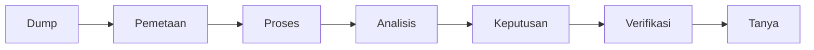
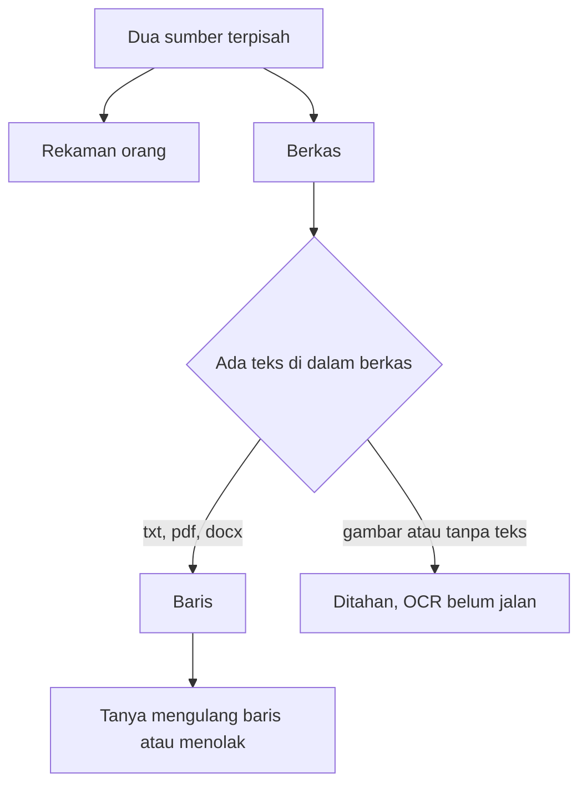

# Naskah singkat untuk CTO

Bacakan ini. Sekitar lima menit. Produk yang dibuka ada di http://127.0.0.1:3000, tombol **Buka contoh produk**.

## Pembuka

Ini prototipe gudang pengetahuan untuk dokumen internal atau dokumen klien. Bukan produk sidang, dan belum produksi. Tujuannya satu: berkas yang belum terstruktur menjadi baris yang bisa ditanya, dan jawabannya tidak boleh lepas dari kutipan.

## Proses bisnis

Ada dua sumber yang sengaja tidak dicampur.

Pertama, rekaman bisnis yang diisi orang: pekerjaan dan orang, masing-masing punya id stabil. Rencana tidak dihitung sebagai kejadian. Nama yang sama tetap dua rekaman.

Kedua, berkas yang di-dump. Sistem memecahnya, menebak jenisnya, lalu menyimpan isian dan klaim. Orang masih yang menerima atau menolak klaim.

Pertanyaan, bentuknya percakapan, hanya boleh membaca baris yang sudah tersimpan. Kalau barisnya tidak ada, sistem menolak. Model tidak menulis SQL.

## Diagram

Bagan yang sama, lebih rinci, ada di `DIAGRAM.md`.

## Peta alur

Halaman Proses menampilkan peta dari dump sampai tanya. Tiap tahap menyebut apa yang dipakai, apa yang masih macet, dan perbaikan berikutnya.

Yang membuatnya bekerja hari ini: Rails, PostgreSQL, dan aturan lokal. Gemini atau model lain belum dipasang. Kalau dipasang nanti, model hanya mengembalikan maksud tertutup. Rails yang menyusun kueri. Jawaban yang tidak menempel pada kutipan ditolak.

PDF yang punya lapisan teks dan DOCX yang punya XML sudah dibaca menjadi teks. Yang masih macet di pemetaan: halaman gambar, OCR, PPTX, rekaman, dan berkas teks yang terlalu besar. Macet di tanya: pencarian masih irisan kata, jadi beda susunan kalimat bisa tidak ketemu.

## Cara kerja, halaman demi halaman

1. **Dump.** Taruh banyak TXT atau Markdown.
2. **Pemetaan.** Teks polos kecil langsung masuk. PDF yang punya lapisan teks diambil per halaman. DOCX diambil dari XML paragraf. Urutan kolom dan tabel belum disusun ulang. OCR hanya untuk halaman yang berupa gambar, dan OCR itu belum dijalankan. Audio butuh transkrip. Berkas teks di atas 200 ribu karakter ditahan. Jalur yang belum ada ditahan, bukan dikira-kira isinya.
3. **Proses.** Tiga penilai berjalan sendiri-sendiri: kata di dalam teks, baris isian seperti `Peserta:` atau `Langkah:`, dan nama berkas.
4. **Analisis.** Tiap bagian punya jenis dan baris struktur. Judul bagian ikut tersimpan, supaya chat tidak membaca satu gumpalan.
5. **Keputusan.** Bentrok tetap kelihatan. Rencana tidak dijadikan kejadian. Klaim yang ditolak tidak dipakai.
6. **Verifikasi.** Kutipan dicek masih ada di teks sumber. Orang yang memutuskan.
7. **Tanya.** Contoh: "Siapa peserta notulen?" mengembalikan `Peserta: Sari dan Budi` beserta judul bagiannya. "Berapa anggaran proposal?" ditolak karena barisnya tidak ada.

## Skema isian

Peserta, langkah, dan anggaran bukan syarat wajib. Itu kolom yang prototipe ini tahu cara menyimpan, untuk empat jenis: SOP, notulen, proposal, dan laporan progres. Chat hanya mengulang baris yang tertulis. Kolom yang tidak ada di berkas tidak dibuat, dan pertanyaannya ditolak.

Ada tiga jalan bila dokumen yang diberikan tidak mencakup struktur itu. Pertama, jenisnya dikenal tetapi satu kolom kosong: berkas tetap masuk, kolom kosong tidak diisi. Kedua, isinya tidak mirip empat jenis itu: jenisnya other, tanpa kolom, kalimat tetap bisa tersimpan sebagai kutipan. Ketiga, label yang belum dikenal, misalnya Risiko atau PIC, tidak disalin menjadi peserta, langkah, atau anggaran.

Bagan ini ada di halaman Proses: lima langkah dari dua sumber sampai tanya, lima kartu jenis, lalu tiga jalan itu.

## Nama berkas

Nama berkas dibaca otomatis, dan disimpan sebagai penanda. Ia bukan pemutus jenis. Kalau nama file `sop-rapat.txt` tetapi isinya notulen, jenisnya tetap notulen, dan penandanya tercatat `nama=sop, diabaikan`. Nama file sering salah. Isi yang menentukan. Kalau isi tidak memberi suara sama sekali, nama berkas juga belum dipakai untuk mengisi jenis. Itu sengaja, supaya label folder tidak menjadi fakta.

## Yang belum selesai dari alur awal

Alur awal yang diminta: unggah, konfirmasi jenis, lalu tanya dengan sumber.

Yang sudah jalan adalah versi jujurnya untuk teks polos: dump, pemetaan, penilai, baris berjudul, keputusan, verifikasi, tanya.

Yang belum:

- PDF digital yang punya lapisan teks sudah diambil per halaman. Urutan kolom dan tabel belum disusun ulang.
- OCR untuk pindaian belum ada. PDF tanpa lapisan teks ditahan.
- DOCX sudah dibaca dari XML paragraf. PPTX belum.
- Audio dan video belum ditranskrip.
- Berkas besar belum dipotong per halaman.
- Belum ada model. Penilai, keputusan, dan verifikasi masih aturan. `semantic` selalu false.
- Belum ada antrian latar. Pemrosesan selesai di dalam permintaan yang sama.
- Belum ada akun, undangan tim, atau enkripsi.
- Chat belum menyusun kalimat. Ia mengulang baris yang ketemu.

## Yang akan diperbaiki, berurutan

1. OCR hanya untuk halaman PDF yang tidak punya lapisan teks. Susun urutan kolom dan tabel.
2. Potong berkas besar per halaman sebelum penilai.
3. Kalau isi abstain dan nama berkas konsisten, nama boleh menjadi penanda lemah, tetap terlihat, tetap bisa dikoreksi satu klik.
4. Model nanti hanya boleh mengembalikan maksud tertutup. Rails yang menyusun query. Model tidak menulis SQL.
5. Jawaban model, kalau dipasang, tetap harus lolos verifikasi kutipan. Kalau gagal, sistem menolak.

## Tutup

Yang bisa dipertahankan hari ini: dua sumber terpisah, jenis tidak dipaksa menang kalau penilai bertentangan, dan pertanyaan yang tidak punya baris tidak dijawab. Yang tidak boleh diklaim: ini sudah OCR, sudah model, atau sudah produksi.
