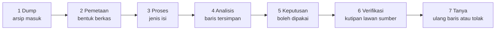
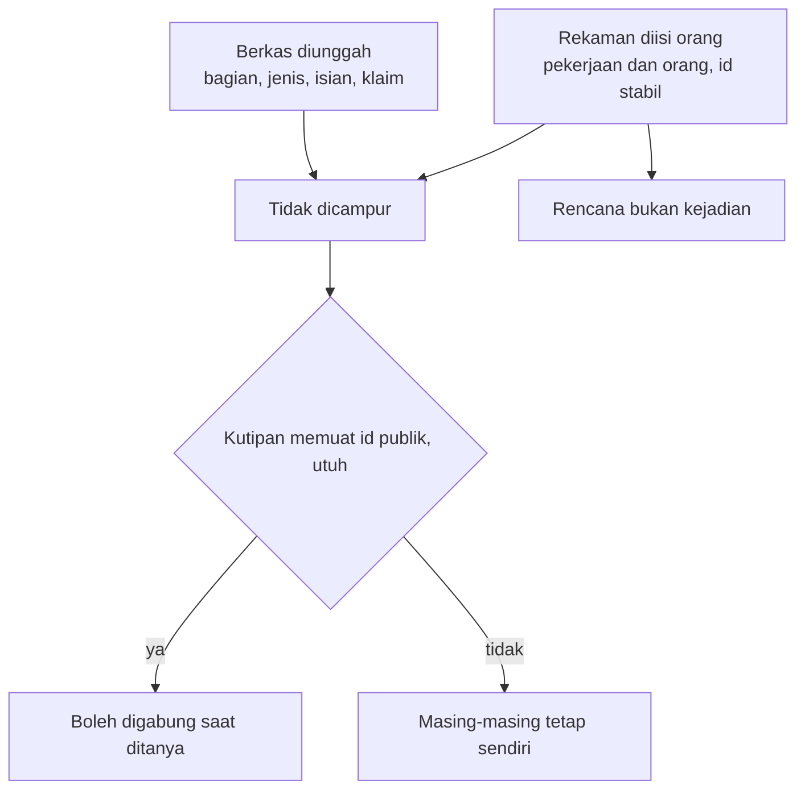
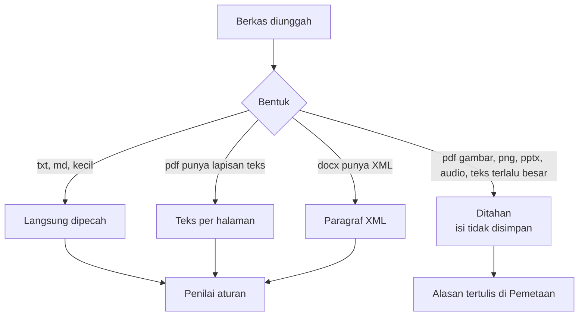
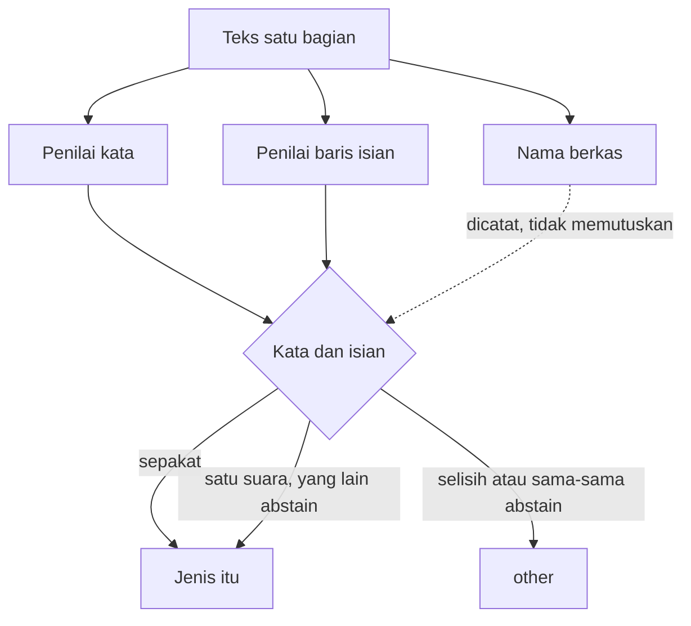
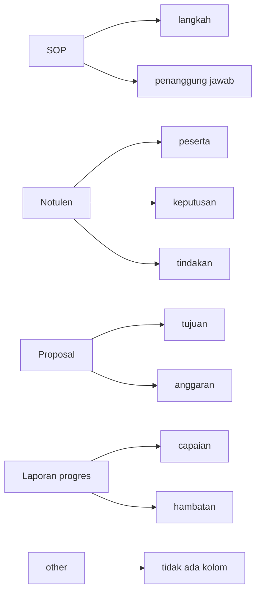
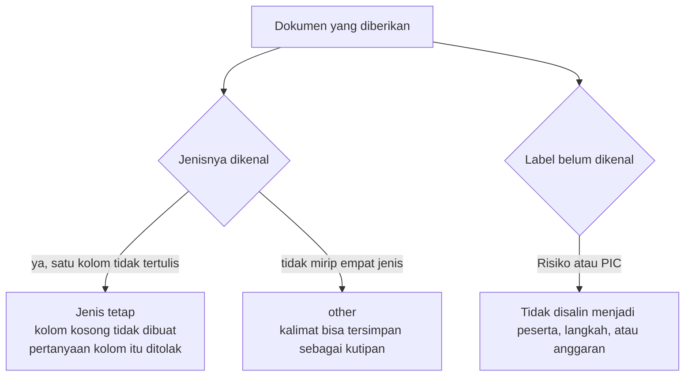
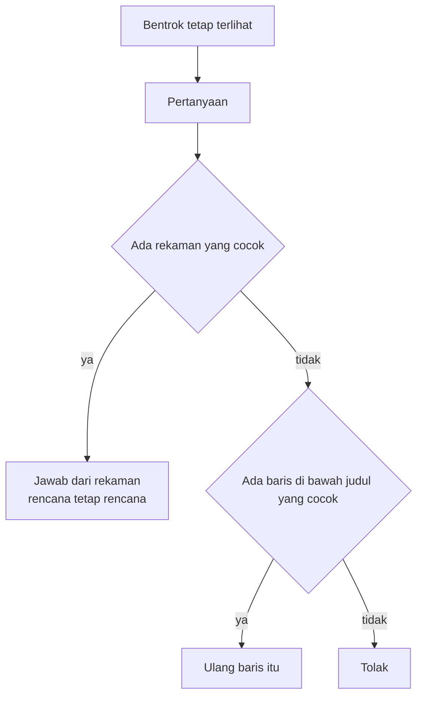
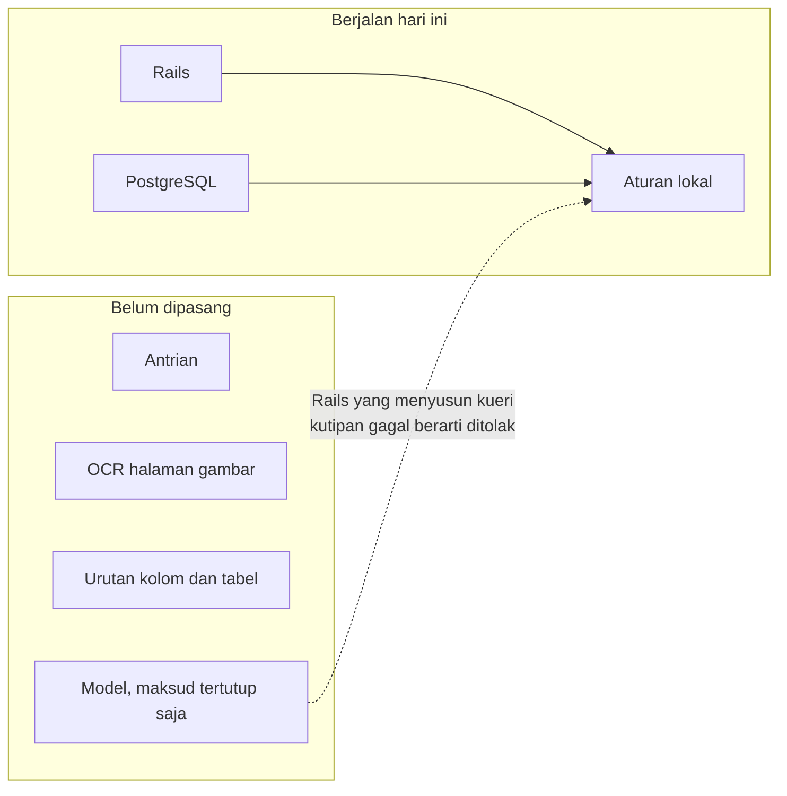

# Diagram notebook operasional

Bagan ini menggambarkan sistem yang berjalan di `ops-notebook`. Kotak kuning adalah batas yang belum dipasang. OCR, model, dan antrian tidak ada di jalur yang sedang berjalan.

## Dari dump sampai tanya

| Tahap | Dipakai | Masih macet |
|---|---|---|
| Dump | Rails dan PostgreSQL | Tidak ada antrian |
| Pemetaan | Lapisan teks PDF dan XML DOCX | OCR, PPTX, transkrip, urutan kolom |
| Proses | Tiga penilai aturan | Prosa tanpa `Nama: nilai` tidak menjadi isian |
| Analisis | Baris PostgreSQL, skema tertutup | Label di luar skema tidak dibuat |
| Keputusan | Aturan bentrok | Bentrok yang dikenali masih sempit |
| Verifikasi | Cek kutipan | Belum ada peninjau kedua |
| Tanya | Irisan kata, `semantic false` | Beda susunan kalimat bisa tidak ketemu |

## Dua sumber

## Bentuk berkas

PDF dan DOCX tidak dijadikan gambar. Halaman tanpa lapisan teks tidak di-OCR. Urutan kolom dan tabel belum disusun ulang.

## Tiga penilai

## Skema isian

Kolom itu batas yang boleh diambil, bukan daftar yang wajib ada. Isian hanya terbaca dari baris sendiri, misalnya `Peserta: Sari`.

## Bila dokumen tidak mencakup kolom itu

## Tanya

## Yang berjalan dan yang belum

