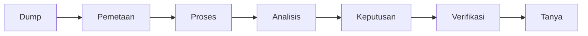
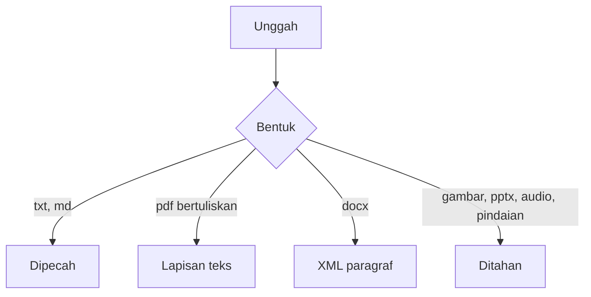

# Cara memakai notebook operasional

Produk ada di folder `ops-notebook`. Ini Rails 7.0.10, Ruby 3.3.2, dan PostgreSQL. Server hanya mendengarkan `127.0.0.1:3000`.

Docker Compose belum disediakan. Jalur yang dicek adalah perintah di bawah ini, pada mesin yang sudah punya Ruby 3.3.2 dan PostgreSQL. Jangan menjalankan `klayer/` atau port 8765. Itu sisa jalur lama.

## Yang perlu terpasang

- Ruby 3.3.2. Di mesin ini dipakai lewat rbenv. Versi Ruby bawaan sistem tidak punya Rails.
- PostgreSQL yang bisa diakses pengguna sistem lewat soket lokal. Nama basis data dibuat otomatis: `ops_notebook_development`.
- Alat kompilasi macOS, karena gem `pg` perlu dikompilasi.

## Menjalankan

Dari akar repositori:

```bash
cd ops-notebook
export RBENV_VERSION=3.3.2
export SDKROOT="$(xcrun --sdk macosx --show-sdk-path)"
bundle install
bin/rails db:prepare
bin/ops
```

Lalu buka http://127.0.0.1:3000.

`bin/ops` sudah mengisi `RBENV_VERSION` dan `SDKROOT`, lalu menjalankan Puma di port 3000. Untuk port lain:

```bash
PORT=3001 bin/ops
```

Menghentikan server: tekan Ctrl+C di terminal yang menjalankan `bin/ops`.

Uji otomatis, dari folder `ops-notebook`, dengan dua variabel lingkungan yang sama:

```bash
bin/rails test
```

## Alur yang terlihat

Bagan yang lebih lengkap ada di [DIAGRAM.md](DIAGRAM.md). Di aplikasi, pita yang sama ada di setiap halaman, dan peta panjangnya ada di **Proses**.





## Memakai produk

1. Di beranda, klik **Buka contoh produk**. Tombol ini membuat satu notebook bernama "Operasional contoh", beberapa rekaman pekerjaan dan orang, serta berkas teks contoh. Data itu dummy.
2. Lewati tujuh halaman dari kiri ke kanan: **Dump**, **Pemetaan**, **Proses**, **Analisis**, **Keputusan**, **Verifikasi**, **Tanya**. Di tiap halaman ada pita alur: apa yang dipakai, apa yang tetap, apa yang macet, dan kandidat berikutnya. Halaman **Proses** memuat peta lengkap.
3. Di **Proses**, baca kartu **Use case berat: 150 PDF**. Adegan itu mengulang sekitar 16 detik: dump beberapa PDF, struktur tersimpan, bentrok antara PDF #3 dan PDF #7, dukungan dari PDF #5 ke PDF #9, lalu tiga baris verifikasi. Kalimat di atas adegan berganti mengikuti sorotan. Ini ilustrasi urutan yang diinginkan untuk dump besar. Klasifikasi aturan hari ini masih terjadi di dalam permintaan unggah. Belum ada antrian, belum ada relasi "berkas ini menguatkan berkas itu", dan verifikasi yang berjalan masih satu cek: kutipan ada di teks.
4. Buka **Riset dan perbandingan**. Halaman `/riset` tidak memakai pita alur. Isinya perbandingan sumber publik dengan perilaku layar ini, daftar berkas `research/`, enam kasus bukti, dan algoritma yang belum dijalankan ulang. Perkiraan 95–98% di halaman itu adalah perkiraan tentang jalur orang lain, bukan recall aplikasi ini.
5. Buka **Handoff**. Halaman `/handoff` menampilkan `HANDOFF.md`: keputusan yang sudah ditutup, janji pondasi, biaya yang belum diukur, proses bisnis berikutnya, syarat verifikasi, koordinasi tim, dan kontrak Docker. Compose belum ada.
6. Yang bekerja hari ini adalah Rails, PostgreSQL, dan aturan lokal. Gemini atau model lain belum dipasang. Perbaikan yang tertulis di peta, termasuk model dan RAG, belum berjalan.
7. Di **Tanya**, tiga pertanyaan siap pakai:
   - "Apa status pilot?" membaca rekaman bisnis. Status rencana tidak dihitung sebagai kejadian.
   - "Apakah pilot sudah berjalan?" tetap rencana, bukan kejadian.
   - "Apakah Budi hadir?" menampilkan bentrok, karena ada kutipan yang saling menolak.
8. Ketik juga "Siapa peserta notulen?". Jawaban mengulang baris `Peserta:` di bawah judul bagian, bukan kalimat yang disusun model.
9. "Berapa anggaran proposal?" ditolak bila baris anggaran tidak ada.

Notebook kosong, tanpa contoh: isi nama ruang, lalu klik **Buat notebook**.

## Menambah berkas sendiri

Di halaman **Dump**, seret berkas atau tempel teks lalu klik **Unggah berkas**.

- `.txt`, `.md`, dan `.markdown` yang kecil langsung dipecah menjadi bagian, jenis, isian, dan klaim.
- Nama berkas harus label, misalnya `notulen-maret.md`. Jangan jalur seperti `folder/berkas.md`.
- Teks yang sama tidak disimpan dua kali.
- PDF yang punya lapisan teks diubah menjadi teks per halaman. DOCX diubah dari XML paragraf. Sistem tidak menjadikan berkas itu gambar, dan tidak menjalankan OCR.
- Gambar, PPTX, audio, video, PDF tanpa lapisan teks, dan teks polos di atas 200.000 karakter muncul di **Pemetaan** dengan status ditahan. Isinya tidak dibaca.
- Koreksi jenis ada di **Analisis**. Pilih jenis bagian, atau klik **Proses ulang**. Koreksi orang tidak ditimpa proses ulang.
- Menerima atau menolak klaim ada di **Verifikasi**. Klaim yang ditolak tidak dipakai untuk menjawab.

Rekaman pekerjaan dan orang diisi terpisah dari berkas. Kalimat di dalam berkas tidak mengubah status mereka. Gabungan rekaman dan berkas hanya terjadi bila kutipan memuat id publik rekaman itu, utuh, sebagai token sendiri.

## Skema isian

Halaman **Proses** menampilkan bagan ini. Empat jenis punya kolom tetap:

- SOP: langkah, penanggung jawab.
- Notulen: peserta, keputusan, tindakan.
- Proposal: tujuan, anggaran.
- Laporan progres: capaian, hambatan.

Kolom itu batas yang boleh diambil, bukan daftar yang wajib ada. Isian hanya terbaca dari baris sendiri, misalnya `Peserta: Sari`.

Jika berkas tidak mencakup struktur itu:

1. Jenisnya dikenal, tetapi satu kolom tidak tertulis. Berkas tetap masuk. Kolom kosong tidak dibuat. Pertanyaan tentang kolom itu ditolak.
2. Isinya tidak mirip empat jenis di atas. Jenisnya `other`. Tidak ada kolom peserta, langkah, atau anggaran. Kalimat tetap bisa tersimpan sebagai klaim.
3. Labelnya belum dikenal, misalnya `Risiko:` atau `PIC:`. Label itu tidak disalin ke kolom yang sudah ada.

## Yang tidak boleh diharapkan

Belum ada akun, antrian latar, atau model. Jawaban bertanda `rules` dan `semantic false`. Adegan 150 PDF di halaman Proses adalah ilustrasi, bukan kapasitas yang sudah diukur. Ini prototipe lokal, bukan produksi.
