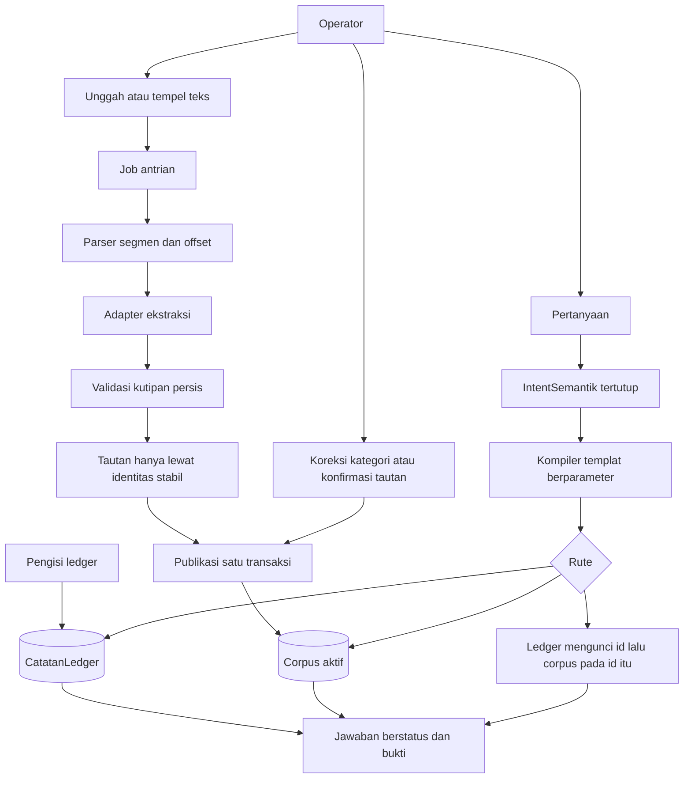

# Proposal proses bisnis dan pengambilan jawaban — agen A

Tanggal: 2026-11-10. Batas demo: 2026-11-11 08:00 WIB. Laporan ini usulan desain. Istilah glosarium di bawah menunggu keputusan koordinator; berkas konteks bersama tidak diubah.

Label bukti:

- **Sumber**: terbaca dari berkas repositori ini atau dari kutipan yang `research/perkara-research.md` tandai sebagai klaim publik.
- **Inferensi**: keputusan desain untuk lingkup demo ini.
- **Tidak diukur**: latency, akurasi model, dan biaya yang tidak ada angkanya di sumber lokal.

## 1. Tafsiran singkat

Kebutuhan yang mengikat adalah repositori pengetahuan lokal dengan **dua kelas sumber yang kepemilikannya berbeda**, lalu satu percakapan yang boleh memakai salah satu atau keduanya.

1. **Catatan operasional terstruktur** hidup di basis data sebagai catatan yang diisi sendiri, bukan hasil tebakan dari berkas.
2. **Dokumen tak terstruktur** masuk sebagai curahan terpisah. Besok pagi penguji membawa dokumen yang belum ada di repositori. Satu dokumen boleh memuat lebih dari satu kategori.
3. Pertanyaan di UI sederhana dapat meminta angka atau status dari catatan operasional, kutipan dari dokumen, atau gabungan keduanya.

Klasifikasi jenis dokumen adalah bagian ingest, bukan tujuan produk. Tujuan produk adalah jawaban yang menunjuk sumber, menolak kalau bukti tidak ada, mempertahankan negasi, membedakan rencana dari kejadian, dan menampilkan bentrok tanpa memilih pemenang diam-diam.

**Inferensi.** Lapisan berkas, struktur, klaim, premis, dan sintesis pada materi publik Perkara AI adalah inspirasi kosakata, bukan spesifikasi yang disalin. `research/perkara-research.md` menyatakan pemetaan lima label animasi ke sebelas nama strata tidak dipublikasikan, dan kategori berkas hukum (BAP, dakwaan, bukti, sidang) terpisah dari tingkat abstraksi. Prototipe ini memakai domain operasional dummy.

**Sumber, klaim penulis 2 Nov 2026, dikutip lewat `research/perkara-research.md`.** Akses model langsung ke basis data lalu penyusunan SQL bebas disebut rentan salah. Semantic model disebut jembatan antara pertanyaan dan data. Untuk perkara mereka, penulis memilih graf pengetahuan berlapis dan menyebut skala sekitar satu juta entitas. Contoh kegagalan yang ditulis: `LIKE '%meeting%'` ikut menjaring kalimat "tidak bisa ikut meeting". Angka skala itu klaim perkara mereka, bukan kuota demo ini.

**Inferensi dari batas waktu dan `DELIVERY.md`.** Aliran terkecil yang utuh harus sudah bisa dijalankan sebagai satu proses loopback, dengan unggah teks yang belum dikenal, ekstraksi model yang sungguhan, dan oracle uji yang terpisah dari implementasi. Oracle tidak boleh menjadi jawaban yang dikunci dari nama berkas.

Asumsi yang dipakai sampai penguji menunjukkan sebaliknya:

- Domain awal adalah operasional satu unit kerja fiktif, bahasa Indonesia, aksara Latin. Bukan berkas perkara.
- Dukungan berkas awal adalah teks UTF-8, Markdown, dan tempel langsung. PDF, pindaian, gambar, audio, dan spreadsheet ditolak dengan alasan yang terbaca.
- Satu operator lokal. Tidak ada klaim keamanan multi-pengguna.
- Catatan operasional dummy dimuat sebelum demo, lewat pintu terpisah dari ingest dokumen.
- Adapter model adalah Grok CLI pada langganan yang sudah masuk. Aplikasi lokal bukan inferensi offline. Tidak ada API berbayar dan tidak ada unduh bobot model.
- Kalimat di dalam dokumen adalah data. Instruksi di dalamnya tidak dijalankan.

## 2. Glosarium yang diusulkan

| Istilah | Arti di produk ini |
| --- | --- |
| Notebook | Wadah satu demo. Memuat satu ledger dan satu corpus. |
| CatatanLedger | Baris operasional yang dimiliki pengisi ledger: karyawan, proyek, baris anggaran, rapat, kehadiran tercatat. Nilainya bukan kebenaran dunia; nilainya adalah apa yang sistem catat. |
| IdentitasStabil | Kunci bisnis yang tidak bergantung pada ejaan nama: `EMP-014`, `PRJ-14`, `MTG-09`, surel unik. |
| Dokumen | Berkas atau tempelan yang dicurahkan ke corpus, beserta hash dan tubuh teks. |
| Segmen | Rentang teks di dalam dokumen, dengan offset ke tubuh asli. Satu dokumen punya banyak segmen. |
| KategoriDokumen | Label taksonomi pada satu segmen: `sop`, `notulen`, `proposal`, `laporan_progres`, `other`. Bukan lapisan abstraksi dan bukan kunci gabungan. |
| Klasifikasi | Usulan atau koreksi kategori pada satu segmen, plus kutipan bukti, metode, dan generasi. |
| Sebutan | Kemunculan sesuatu di teks, dengan span. Boleh tertaut ke IdentitasStabil atau tetap `unresolved`. |
| Klaim | Kalimat dokumen yang disimpan bersama kutipan persis, polaritas, modalitas, predikat, dan atribusi. Klaim bukan CatatanLedger. |
| Tautan | Hubungan Sebutan ke IdentitasStabil. Status `unique_auto` hanya jika teks memuat identitas stabil. Status `confirmed` hanya setelah operator mengunci. Nama saja tetap `unresolved`. |
| Bentrok | Dua bukti aktif pada subjek dan predikat yang sama yang tidak dapat sama-sama dipakai, atau CatatanLedger dan Klaim yang tidak sepakat. Keduanya tetap tampil. |
| IntentSemantik | Objek tertutup hasil perencana. Bukan SQL, bukan perintah, bukan prosa jawaban. |
| Jawaban | Hasil kompiler: status, rute, bukti, dan alasan. Prosa model tidak menjadi jawaban. |
| LapisanData | CatatanLedger plus dokumen, segmen, hash, dan offset. |
| LapisanSemantik | Klasifikasi, klaim, sebutan, tautan, dan bentrok yang menunjuk kembali ke lapisan data. |
| KategoriDokumen | Bukan lapisan. Memilih bidang tambahan yang diekstrak, tanpa mengubah aturan polaritas, modalitas, atau gabungan. |

Modalitas yang dipakai aliran terkecil: `asserted` (disebut sebagai kejadian atau keadaan), `plan` (direncanakan atau dijadwalkan), `directive` (langkah atau suruhan di SOP). Polaritas: `affirmed` atau `negated`. Pertanyaan "apakah sudah terjadi" hanya terpenuhi oleh `asserted` + `affirmed` yang tidak berbentrok. `plan` dan `directive` tidak memenuhi kejadian.

## 3. Aktor, objek, kepemilikan, dan aliran

### Aktor

- **Pengisi ledger.** Memuat dan mengganti CatatanLedger dummy sebelum dokumen diolah. Boleh orang yang sama dengan operator, tetapi lewat modul Ledger, tidak lewat unggah.
- **Operator.** Mencurahkan dokumen tak terlihat, membaca status job, mengoreksi kategori, mengonfirmasi tautan yang masih nama, dan bertanya.
- **Adapter model.** Mengusulkan kategori, klaim, sebutan, dan IntentSemantik. Tidak menulis ledger dan tidak menulis SQL.
- **Penguji.** Besok memakai dokumen baru dan pertanyaan baru. Bukan sumber kebenaran yang dikodekan sebagai fixture.

### Kepemilikan

| Objek | Pemilik | Siapa yang boleh menulis | Siapa yang hanya membaca |
| --- | --- | --- | --- |
| CatatanLedger | Pengisi ledger | Pemuat dummy | Ingest, kompiler, UI |
| Dokumen dan segmen | Corpus | Ingest | Kompiler, UI |
| Lapisan semantik aktif | Publikasi job atau koreksi operator | Ingest setelah validasi; operator untuk kategori dan tautan | Kompiler |
| IntentSemantik | Permintaan saat itu | Perencana, lalu dibuang setelah dikompilasi | Kompiler |
| Jawaban | Modul Ask | Perender dari baris hasil | UI |

Dokumen yang menyebut angka anggaran menjadi Klaim. Angka itu tidak mengubah baris anggaran. Koreksi dunia usaha, kalau ada, adalah tindakan pengisi ledger.

### Modul dan seam

Kosakata desain: **Module**, **Interface**, **Seam**, **Adapter**. Kedalaman diukur dari daya ungkit antarmuka, bukan dari jumlah tabel.

Tiga modul cukup. Pemanggil dan uji melewati antarmuka yang sama.

- **Ledger.** Antarmuka baca: ambil menurut IdentitasStabil, dan hitung kecocokan nama tanpa menggabungkan ke dokumen. Penulisan hanya ada pada pemuat dummy. Ingest tidak menerima pegangan tulis.
- **CorpusIngest.** Antarmuka: unggah, status job, ulang job gagal, koreksi kategori, konfirmasi tautan. Di dalamnya: parser teks, adapter ekstraksi, validasi span, pengusul tautan, publikasi transaksional.
- **Ask.** Antarmuka: satu pertanyaan masuk, satu Jawaban keluar. Di dalamnya: adapter perencana, pemeriksa intent, kompiler templat SQL berparameter, perender status.

Seam yang sungguhan hanya adapter penyedia, karena dua implementasi harus bisa dipertukarkan: Grok CLI dan jalur `local-rules` yang dipilih eksplisit. Parser, validator, dan kompiler tidak perlu seam kedua selama hanya ada satu implementasi. Satu adapter berarti seam itu masih hipotetis.

Uji penghapusan: jika Ask hilang, setiap pemanggil harus mengulang kebijakan rute, ambiguitas, dan rencana-lawan-kejadian. Kebijakan itu tinggal di Ask supaya lokalitasnya utuh.

### Kapan ledger, corpus, atau gabungan

Kompiler memilih rute dari slot IntentSemantik, bukan dari kemiripan kata pertanyaan dengan isi dokumen.

| Situasi pertanyaan | Rute | Yang dikonsultasi | Yang tidak dilakukan |
| --- | --- | --- | --- |
| Menanyakan nilai tercatat: jumlah, status, pemilik, kehadiran menurut sistem. Subjek punya IdentitasStabil. | Ledger | Tabel operasional saja | Kutipan dokumen tidak mengisi angka yang kosong |
| Menanyakan apa yang dokumen nyatakan, termasuk rencana, suruhan, atau negasi. | Corpus | Klaim aktif yang tautannya sah | Status ledger tidak dipakai untuk memilih tanggal atau membalik negasi |
| Butuh identitas dari ledger dan predikat dari dokumen pada identitas yang sama | Gabungan | Ledger lebih dulu untuk mengunci id, lalu klaim dengan `entity_id` yang sama | Nama yang sama tidak menjadi syarat `JOIN` |
| Nama cocok dengan dua identitas atau lebih | Berhenti | Daftar kandidat id | Tidak ada rute lanjutan |
| Katalog tidak punya predikat, atau kedua sumber kosong | Abstain | Sumber yang relevan, hasil kosong | Tidak menebak dari baris terdekat |
| Jenis berkas atau kemampuan di luar dukungan | Unsupported | Tidak ada ekstraksi | Tidak ada teks palsu |

Urutan gabungan selalu ledger lalu corpus pada id yang sama. Sebutan `unresolved` boleh ditampilkan sebagai daftar samping dan tidak masuk larik bukti.

### Aliran ingest dokumen tak terlihat

1. Operator mengunggah satu tubuh teks atau menempelkannya. Nama berkas adalah label, bukan jalur, dan bukan penentu kategori.
2. Tubuh kosong, tubuh di atas batas karakter, nama berjalur, atau byte non-teks ditolak. Kode kesalahan terbaca. Tidak ada job.
3. Hash sama dengan dokumen yang sudah ada di notebook yang sama mengembalikan dokumen itu. Tidak ada klaim aktif kedua.
4. Job tercatat `queued`, lalu `running`. Parser memecah segmen pada baris kosong dan menjaga offset. Offset yang tidak cocok dengan tubuh menggagalkan job.
5. Adapter model membaca tiap segmen sebagai data dan mengembalikan kategori, kutipan, polaritas, modalitas, predikat, serta sebutan. Metode dan label penyedia disimpan.
6. Validasi menolak kutipan yang bukan substring persis pada offset itu. Kategori selain `other` tanpa kutipan bukti di dalam segmen ditolak. Instruksi di dalam teks tidak menjadi perintah.
7. Pengusul tautan memberi `unique_auto` hanya jika span memuat IdentitasStabil yang tepat satu baris ledger. Nama, termasuk nama yang kebetulan unik, tetap `unresolved`.
8. Publikasi satu transaksi: generasi lama segmen itu menjadi `stale`, baris baru menjadi `active`, job `completed`. Job yang gagal atau terputus sebelum commit tidak meninggalkan baris aktif dari percobaan itu.
9. Kegagalan adapter mengakhiri job dengan pesan penyedia. Tidak ada penerbitan diam-diam lewat aturan leksikal. Operator dapat meminta ulang pada adapter `local-rules`; label itu tetap `local-rules` di klasifikasi dan tidak disebut ekstraksi semantik.

### Aliran tinjau dan ubah

- Operator melihat kategori per segmen, bidang kategori, klaim, dan sebutan belum tertaut. Rollup dokumen menjadi `mixed` bila segmen aktif memuat lebih dari satu kategori.
- Koreksi kategori memproses ulang segmen itu, menandai bidang skema lama sebagai `stale`, dan menyimpan teks sumber.
- Konfirmasi tautan mengikat satu sebutan ke satu IdentitasStabil. Penolakan tautan menjaga sebutan di luar gabungan.
- Perubahan ledger adalah transaksi pemuat dummy. Chat dan dokumen tidak memicu perubahan itu.
- Unggah ulang byte yang sama tidak membuat generasi baru. Teks yang berubah adalah dokumen baru dengan hash baru; dokumen lama tetap dapat dibuka.

### Aliran tanya

1. Pertanyaan kosong ditolak.
2. Perencana mengembalikan IntentSemantik atau `abstain`. Keluaran yang memuat SQL, perintah, atau kunci di luar katalog ditolak. Tidak ada eksekusi.
3. Jika perencana gagal, Ask mengembalikan abstain dengan kesalahan penyedia. Jalur leksikal tidak menyamar menjadi perencana semantik.
4. Kompiler memilih satu templat dari katalog tetap dan mengikat parameter. Teks pertanyaan tidak digabung ke string SQL.
5. Perender mengisi status dari baris. Model tidak menulis kalimat jawaban.

Status jawaban: `grounded`, `conflict`, `plan_not_occurrence`, `abstain`, `ambiguous`, `unsupported`.

### Aliran kesalahan yang harus terlihat

- Format tidak didukung, tubuh kosong, tubuh terlalu besar, nama berkas berjalur.
- Job `failed` dengan alasan, tanpa klaim aktif baru. Ulang hanya dari `failed`. Ulang yang berhasil menerbitkan satu kali.
- Sitasi yang bukan substring ditolak pada publikasi.
- Rencana tidak sah tidak dijalankan.
- Subjek ambigu mengembalikan kandidat dan berhenti.
- Bukti kosong mengembalikan abstain dan menyebut sumber yang dikonsultasi.
- Restart menandai job `running` yang terputus sebagai gagal dan tidak menampilkan publikasi setengah jadi.



### Kontrak IntentSemantik

Bidang yang dikenali kompiler:

| Bidang | Isi yang sah |
| --- | --- |
| route | `ledger`, `corpus`, `combined`, `abstain` |
| operation | `lookup`, `compare`, `exists` |
| subject_kind | `employee`, `project`, `meeting`, `budget` |
| subject_id | IdentitasStabil atau kosong |
| name_hint | String pendek untuk resolusi nama ledger, bukan untuk `JOIN` dokumen |
| predicate | `project_status`, `budget_reserved`, `budget_spent`, `attendance`, `schedule` |
| polarity | `affirmed`, `negated`, atau kosong |
| modality | `asserted`, `plan`, `directive`, atau kosong |
| meeting_id | IdentitasStabil rapat atau kosong |

Templat yang dikompilasi, semuanya berparameter:

- Status dan pemilik proyek menurut `project_id`.
- Baris anggaran menurut `project_id`.
- Kehadiran tercatat menurut `meeting_id` dan `employee_id`.
- Hitung karyawan yang nama tampilannya cocok dengan `name_hint`. Hasil dihitung. Dua atau lebih menghentikan pertanyaan sebagai `ambiguous`. Satu hasil hanya menjawab pertanyaan ledger tentang nama itu.
- Klaim aktif menurut `entity_id`, predikat, dan filter polaritas atau modalitas. Syarat tautan: `unique_auto` atau `confirmed`.
- Pasangan bentrok aktif pada `entity_id` dan predikat yang sama.

`quote_contains` tidak masuk katalog. Pencarian `LIKE` atas kalimat adalah jalur yang klaim penulis 2 Nov 2026 tunjukkan gagal pada negasi (**Sumber** lewat riset lokal). Kecocokan kata tetap boleh dipakai manusia saat meninjau, dan tidak memakai status bukti.

## 4. Contoh kerja sintetis

Data ini independen dari fixture yang sudah ada. Ledger dimuat sebagai baris. Dokumen dicurahkan kemudian sebagai teks. Tidak ada kalimat dokumen yang menjadi sumber pengisian ledger.

### CatatanLedger

Karyawan:

| Id | Nama tampilan | Surel |
| --- | --- | --- |
| EMP-014 | Sari Wibowo | sari.wibowo@contoh.invalid |
| EMP-027 | Budi Santoso | budi.santoso@contoh.invalid |
| EMP-031 | Budi Hartono | budi.hartono@contoh.invalid |
| EMP-044 | Dana Kusuma | dana.kusuma@contoh.invalid |

Proyek `PRJ-14`, nama "Pilot menu dapur", `owner_id` EMP-014, status `planned`, awal rencana `2026-11-15`.

Anggaran `BL-14`, proyek `PRJ-14`, jumlah `25000000`, keadaan `reserved`.

Rapat `MTG-09`, tanggal `2026-03-14`, proyek `PRJ-14`. Kehadiran tercatat: EMP-014 hadir menurut sistem. EMP-027 dan EMP-031 tidak punya baris kehadiran.

### Dokumen yang dicurahkan

Berkas `notulen-dan-sop.txt`, dua segmen dipisah baris kosong. Kategori yang diharapkan setelah ekstraksi sungguhan: segmen pertama `notulen`, segmen kedua `sop`, rollup dokumen `mixed`. Harapan kategori ini adalah oracle uji, bukan tabel yang dikunci dari nama berkas.

```
Notulen rapat operasional MTG-09.

Peserta: Sari Wibowo, Budi Santoso.
Keputusan: pilot PRJ-14 direncanakan mulai 15 November.
Menurut notulen ini, EMP-014 hadir di rapat MTG-09.

SOP pembukaan dapur uji.

Langkah 1: periksa cadangan anggaran pada catatan sistem.
Penanggung jawab: EMP-014.
```

Berkas `catatan-dana.txt`, satu segmen. Kategori yang diharapkan: `other` atau `notulen` hanya jika kutipan bukti ada di dalam segmen. Isi berikut yang menjadi oracle jawaban, apa pun kategori akhirnya:

```
Catatan dari Dana Kusuma tentang PRJ-14.
Pilot PRJ-14 direncanakan mulai 1 Desember.
EMP-014 tidak hadir pada MTG-09.
Budi tidak bisa ikut meeting dengan Pejabat Z.
Anggaran PRJ-14 disebut sudah terpakai 40 juta.
```

Tautan yang sah tanpa konfirmasi manusia: setiap span yang memuat `PRJ-14`, `EMP-014`, atau `MTG-09`. "Sari Wibowo", "Budi Santoso", dan "Budi" tetap `unresolved`. Langkah SOP adalah bidang kategori atau klaim `directive`, dan tidak mengubah `BL-14`.

### Pertanyaan 1 — ledger saja

"Berapa nilai anggaran PRJ-14 yang tercatat di sistem, dan apakah proyek itu sudah berjalan?"

- Rute: ledger.
- Hasil yang diharapkan: `BL-14` jumlah `25000000` keadaan `reserved`; `PRJ-14` status `planned` dengan awal rencana `2026-11-15`.
- Status: `plan_not_occurrence` untuk bagian "sudah berjalan", plus nilai cadangan yang `grounded`. Status `planned` dan keadaan `reserved` tidak dipakai sebagai kejadian atau sebagai dana terpakai.
- Bukti: dua kunci ledger itu saja.
- Kalimat "sudah terpakai 40 juta" tidak masuk bukti, karena pertanyaan mengunci kelas sumber pada catatan sistem.

### Pertanyaan 2 — dokumen saja

"Apakah dokumen menyatakan pilot PRJ-14 sudah berjalan?"

- Rute: corpus. Subjek `PRJ-14` dari identitas di pertanyaan. Predikat `schedule`.
- Bukti yang diharapkan, keduanya modalitas `plan`:
  - "pilot PRJ-14 direncanakan mulai 15 November."
  - "Pilot PRJ-14 direncanakan mulai 1 Desember."
- Status: `plan_not_occurrence`. Tanggal rencana bentrok dan keduanya dipertahankan. Tidak ada klaim `asserted` bahwa pilot sudah berjalan.
- `2026-11-15` pada ledger tidak menyamakan frasa "15 November" dan tidak memilih pemenang. Tahun tidak ditebak.

### Pertanyaan 3 — gabungan, negasi, dan bentrok lintas sumber

"Apakah pemilik PRJ-14 hadir pada MTG-09?"

- Rute: gabungan.
- Ledger mengunci pemilik `PRJ-14` menjadi EMP-014.
- Klaim dengan tautan `EMP-014`, predikat `attendance`, rapat `MTG-09`:
  - "Menurut notulen ini, EMP-014 hadir di rapat MTG-09." Polaritas `affirmed`, modalitas `asserted`.
  - "EMP-014 tidak hadir pada MTG-09." Polaritas `negated`, modalitas `asserted`.
- Kehadiran tercatat ledger: EMP-014 hadir pada MTG-09.
- Status: `conflict`. Tiga bukti tetap. Kehadiran ledger tidak menghapus kalimat negasi. Angka tidak dirata-rata dan tidak ada suara terbanyak.
- Baris peserta "Sari Wibowo" tidak masuk bukti, karena sebutan itu belum tertaut.

Bentrok anggaran adalah pemeriksaan tambahan pada subjek yang sama, bukan pertanyaan keempat yang wajib di UI: klaim "Anggaran PRJ-14 disebut sudah terpakai 40 juta" lawan `BL-14` keadaan `reserved`. Jawaban atas "apakah anggaran PRJ-14 sudah terpakai" berstatus `conflict`, dengan kedua kelas sumber, tanpa menulis ulang `BL-14`.

### Pertanyaan 4 — tidak terjawab

"Siapa penyewa gudang pada 2025?"

- Ledger tidak punya objek sewa. Corpus tidak punya klaim aktif tentang penyewa gudang.
- Status: `abstain`. Alasan menyebut kedua sumber kosong.
- Daftar karyawan dan angka `BL-14` tidak dijadikan jawaban pengganti.

### Pertanyaan 5 — entitas ambigu

"Apakah Budi hadir di MTG-09?"

- Resolusi nama mengembalikan EMP-027 Budi Santoso dan EMP-031 Budi Hartono.
- Status: `ambiguous`. Bukti kosong. Kandidat kedua id ditampilkan.
- Kalimat "Budi tidak bisa ikut meeting dengan Pejabat Z" tetap sebutan `unresolved`. Kalimat itu tidak diatribusikan ke salah satu Budi, tidak dibalik menjadi kehadiran, dan tidak masuk larik bukti. Daftar samping boleh menunjukkannya sebagai belum tertaut.
- Kehadiran ledger tidak dipakai, karena subjeknya belum satu id.

### Dokumen tak terlihat pada pagi demo

Penguji menempel teks baru yang memuat kata nonce. Penerimaan minimum: job selesai lewat adapter yang benar-benar dipanggil, kutipan hasil memuat nonce itu sebagai substring sumber, metode tercatat, dan nama berkas `sop.txt` tidak memaksa kategori bila isinya bukan SOP. Kegagalan CLI tampil sebagai job gagal, kecuali operator dengan sengaja memilih `local-rules`.

## 5. Opsi arsitektur dan tradeoff

Tiga opsi dibanding pada kecocokan kasus, kebenaran gabungan, biaya dirikan dan pelihara, latency, dan batas besok pagi. Tidak ada skor angka. Latency tidak diukur di laporan ini.

### Model semantik relasional

Kasus demo adalah pencarian kunci, satu lompatan kepemilikan, dan filter polaritas atau modalitas. Catatan operasional sudah berbentuk baris. Intent tertutup dikompilasi ke templat berparameter. Kunci asing dan transaksi menjaga generasi aktif. Entitas ambigu menjadi hitungan baris, bukan sisi graf yang lahir dari kata yang sama.

Biaya dirikan: perluasan skema pada basis relasional yang sudah dipakai proses ini, plus katalog templat. Biaya pelihara: predikat baru adalah perubahan katalog yang terlihat, bukan prompt yang bebas menulis kueri. Latency jalur jawab ditentukan kueri lokal; waktu model ada di ingest dan, bila dipakai, di perencana intent. Muat dalam batas satu malam karena tidak menambah mesin kedua.

**Sumber.** Penulis 2 Nov 2026 mengatakan semantic model adalah jembatan yang tepat untuk menghindari SQL bebas, dan menyuruh pembaca memilih jenis yang cocok untuk domainnya. Pilihan graf mereka terikat perkara dan skala yang mereka sebut.

### Desain berbahan graf

Graf berjenis cocok bila penelusuran banyak lompatan dan ontologi besar adalah produknya. Kasus di bagian 4 adalah equality id: proyek ke pemilik, pemilik ke klaim, klaim ke span. Tabel tautan di dalam basis relasional menyimpan sisi yang sama.

Graf tidak menyelesaikan nama ganda. Sisi "nama mirip" akan mengulang kegagalan gabungan yang justru dibatasi. Mesin graf terpisah menambah proses, cadangan, dan konsistensi lintas penyimpanan pada data yang masih puluhan baris. Klaim sejuta entitas (**Sumber**, penulis) tidak terlihat pada lingkup dummy ini. Latency graf pada ukuran ini tidak diukur dan tidak dipakai sebagai alasan.

Menjelang 08:00, mesin graf baru tidak masuk aliran terkecil. Sisi yang sudah dikonfirmasi tetap disimpan sebagai baris.

### Pengambilan yang bertumpu embedding

Embedding berguna bila rumusan pertanyaan jauh dari rumusan teks dan yang dicari adalah kandidat span. Ia tidak pantas menjadi catatan operasional: jumlah `25000000` harus datang dari `BL-14`. Kemiripan vektor juga bukan IdentitasStabil. Dua orang bernama Budi dapat saling berdekatan. Kalimat negasi dapat tetap terambil bersama kalimat afirmatif kecuali polaritas menjadi filter terstruktur sesudah pengambilan. Klaim publik yang ada adalah kegagalan `LIKE` pada negasi, bukan hasil ukur embedding di repo ini (**Sumber** versus **tidak diukur**).

`DELIVERY.md` menahan unduh bobot besar dan API berbayar tanpa keputusan terpisah. Tidak ada adapter embedding di pohon kode saat ini. Menambahkannya melewati batas demo. Kalau nanti ada penyedia yang sudah terpasang, tempatnya adalah pengusul kandidat span di dalam tinjauan, di belakang filter predikat, dan di luar syarat gabungan.

### Landasan basis data

CTO menyebut PostgreSQL atau landasan lain yang diberi alasan. Itu bimbingan, bukan identitas produk.

Lingkup yang benar-benar ada: satu operator, satu proses loopback, puluhan baris dummy, dokumen teks kecil, kebutuhan kunci asing, unik, dan satu transaksi publikasi. SQLite sudah menjadi penyimpanan proses `klayer` (`klayer/store.py` membuka `sqlite3`, jurnal WAL, satu kunci utas). Syarat benar untuk dua kelas sumber adalah dua kepemilikan di dalam satu basis, bukan dua mesin.

PostgreSQL masuk akal bila penguji membutuhkan banyak penulis bersamaan, peran basis data, atau sebuah URL server yang sudah menjadi harness uji. Biayanya pada demo ini adalah proses server dan pustaka klien di luar aplikasi satu berkas. Materialized view dan ETL kejadian, yang disebut penulis sebagai pilihan implementasi pada beberapa kasus mereka (**Sumber**, klaim penulis), tidak menjawab pertanyaan bagian 4. Demo belum punya beban yang membuat view itu perlu.

Dua berkas basis data, satu untuk ledger dan satu untuk corpus, membuat kepemilikan terlihat secara fisik, tetapi menggandakan cadangan dan transaksi. Tautan lintas berkas dapat yatim. Satu berkas dengan awalan tabel `ledger_` dan `corpus_` menjaga satu commit. Batas tulis ditegakkan di modul: CorpusIngest tidak memegang metode tulis Ledger. Uji penerimaan menghitung baris ledger sebelum dan sesudah unggah.

**Inferensi.** Landasan yang dipilih adalah SQLite satu berkas, dua kelompok tabel. PostgreSQL tidak ditolak sebagai produk; ia belum punya pekerjaan yang tidak dapat dikerjakan landasan yang sudah hidup di proses ini. SQLite juga tidak dipilih karena tinggal menyalakan berkas yang ada: skema yang ada belum memuat kelas sumber operasional.

## 6. Keputusan yang diusulkan

Aliran lengkap yang terkecil:

1. Pemuat dummy menulis karyawan, proyek, anggaran, rapat, dan kehadiran tercatat ke kelompok `ledger_`.
2. Operator mencurahkan teks tak terlihat ke kelompok `corpus_`.
3. Job menjalankan adapter model, memvalidasi span, dan menautkan hanya identitas stabil.
4. Operator dapat mengoreksi kategori dan mengonfirmasi nama.
5. Ask mengubah pertanyaan menjadi IntentSemantik, mengompilasi templat berparameter, dan mengembalikan status serta bukti.
6. Oracle tiga pertanyaan di bagian 4, plus kasus ambigu dan abstain, adalah pemeriksa evaluasi. Implementasi tidak membaca kunci jawaban berdasarkan nama berkas.

Yang ditunda dengan sengaja: premis, sintesis, council agen, mesin graf, embedding, Postgres, PDF, dan rekaman. `research/perkara-research.md` sudah memisahkan strata publik dari spec. Menambah premis tanpa pertanyaan demo yang memakainya memperbesar antarmuka Ask tanpa daya ungkit baru.

Perilaku penyedia: ekstraksi dan klasifikasi dokumen baru melewati model. Kegagalan model gagal tertutup. `local-rules` adalah tindakan operator yang labelnya jujur, untuk menjaga demo tetap bisa jalan, dan tidak dihitung sebagai mutu semantik. Tidak ada janji bebas halusinasi. Sisa risiko yang nyata: model dapat menyalin span dengan benar sambil keliru pada polaritas atau predikat. Karena itu penerimaan memisahkan invarian mesin dari pemeriksaan mutu model.

## 7. Celah kode saat ini

Dibaca dari `klayer/store.py`, `klayer/pipeline.py`, `klayer/domain.py`, `klayer/providers.py`, `klayer/server.py`, dan `README.md`. Ini ketidaksesuaian dengan kebutuhan dua sumber, bukan penilaian bahwa pekerjaan yang sudah ada harus dibuang.

Fondasi yang selaras dengan aliran ini dan layak dipertahankan: hash dokumen, offset segmen, publikasi yang menandai generasi lama `stale`, status job, penolakan kutipan yang bukan substring, kategori per segmen dengan rollup `mixed`, modalitas `plan` yang terpisah dari kejadian pada jalur leksikal pilot, serta intent yang tidak menerima SQL bebas.

Celah terhadap kebutuhan CTO:

1. Skema hanya memuat notebook, dokumen, job, segmen, klasifikasi, klaim, bidang, dan relasi. Tidak ada karyawan, proyek, anggaran, rapat, atau kehadiran tercatat. README menyatakan tidak ada Postgres; yang juga tidak ada adalah kelas sumber operasional itu sendiri pada SQLite yang sedang dipakai.
2. `structured_query` hanya mengenal `list_claims` dan `compare_claims` atas klaim dokumen. Tidak ada rute ledger atau gabungan. Pertanyaan anggaran tercatat tidak punya tempat membaca.
3. `conflicting_pairs` di `domain.py` memasangkan klaim kehadiran bila himpunan token nama kapital beririsan. Itu gabungan berdasarkan kata. `PRJ-14` dan `EMP-014` tidak ada sebagai kunci.
4. Predikat yang diizinkan hanya `attendance` dan `pilot`. Katalognya tidak memuat status proyek, anggaran, atau rapat.
5. `_run_provider` pada kegagalan model menerbitkan hasil `local-rules` dan tetap menyelesaikan job, dengan peringatan. Label metode jujur, tetapi dokumen tak terlihat terlihat "selesai" tanpa ekstraksi model. Untuk uji besok, kegagalan penyedia harus menjadi job `failed` kecuali operator memilih jalur aturan.
6. README menyatakan seed fixture selalu lewat `local-rules`. Itu masuk akal agar start tidak menunggu model, dan tidak menggantikan unggah teks baru lewat adapter model.
7. Perencana boleh mengisi `quote_contains`, lalu `search_claims` menjalankan `LIKE`. Jalur itu leksikal. Negasi dapat lolos sebagai kena kata.
8. Tidak ada status `ambiguous` dan tidak ada resolusi nama yang menghentikan gabungan.
9. Unggah mengharapkan string. Penolakan format biner yang eksplisit belum menjadi kontrak yang terlihat operator, di luar tubuh kosong dan batas 200000 karakter.
10. Relasi diisi ulang untuk seluruh notebook dari pasangan leksikal setelah publikasi. Bukan sisi yang lahir dari identitas stabil.
11. Tidak ada batas modul yang menjaga ingest dari menulis catatan operasional, karena catatan itu belum dimodelkan.
12. Klasifikasi ganda per dokumen sudah mungkin lewat beberapa segmen. Satu span dengan dua kategori sekaligus belum. Aliran terkecil cukup memakai banyak segmen dan rollup `mixed`, asalkan parser tidak memaksa satu label per berkas.

## 8. Invarian dan penerimaan

Invarian:

1. CorpusIngest tidak menambah, mengubah, atau menghapus baris `ledger_`.
2. Setiap klaim aktif adalah substring persis tubuh dokumen pada offset yang disimpan, dan hash tubuh tetap.
3. Teks pertanyaan dan teks dokumen tidak pernah menjadi SQL atau perintah shell. Hanya templat katalog dengan parameter terikat.
4. Bukti gabungan memakai equality IdentitasStabil pada tautan `unique_auto` atau `confirmed`. Irisan nama tidak menghasilkan bukti.
5. `plan` dan `directive` tidak memenuhi pertanyaan kejadian. `negated` dikembalikan sebagai negasi, tidak dibuang dan tidak dibalik.
6. Dua bukti aktif yang tidak sepakat pada identitas dan predikat yang sama menghasilkan `conflict` dengan kedua sitasi.
7. Hash yang sama tidak membuat himpunan klaim aktif kedua.
8. Job gagal atau terputus sebelum commit tidak meninggalkan klaim aktif dari percobaan itu. Restart mempertahankan notebook.
9. Kategori bukan kunci gabungan. Dokumen dengan dua kategori segmen tampil `mixed`.
10. Sebutan `unresolved` tidak muncul di larik bukti.
11. Frasa tanggal di dokumen tidak disamakan dengan tanggal kanonik ledger tanpa nilai kanonik di kedua sisi.
12. Sitasi yang gagal validasi span tidak diterbitkan.

Penerimaan yang dapat dijalankan:

- Setelah pemuat dummy dan sebelum unggah, pertanyaan 1 mengembalikan `BL-14` dan `PRJ-14` saja.
- Unggah kedua teks bagian 4 lewat adapter model pada isi yang tidak dikunci nama berkas. Pertanyaan 2 mengembalikan dua kutipan `plan` dan status `plan_not_occurrence`.
- Pertanyaan 3 mengembalikan `conflict` dengan kedua kalimat EMP-014 dan baris kehadiran ledger, tanpa pemenang.
- Pertanyaan penyewa gudang berstatus `abstain` dan tidak menyebut `25000000`.
- Pertanyaan "Budi" berstatus `ambiguous` dengan EMP-027 dan EMP-031, bukti kosong.
- Tempelan baru berisi nonce menghasilkan kutipan yang memuat nonce itu, dengan metode penyedia tercatat.
- Berkas dua segmen pada contoh mendapat dua klasifikasi dan rollup `mixed`.
- Koreksi kategori menandai bidang skema lama `stale` dan mempertahankan tubuh teks.
- Unggah ulang byte yang sama tidak menambah klaim aktif.
- Dokumen yang berisi suruhan mengubah atau menghapus ledger tidak mengubah jumlah baris ledger.
- Kutipan palsu dari adapter yang dimodelkan di uji ditolak.
- Tubuh kosong dan berkas non-teks mendapat kode kesalahan, tanpa job selesai.
- Proses terputus saat `running`: setelah dibuka lagi job itu `failed` dan tidak ada klaim aktif baru dari percobaan itu.
- Intent dengan kunci di luar katalog atau dengan SQL di dalamnya ditolak dan tidak mengubah basis.

Pemisahan hasil: butir di atas adalah asersi otomatis. Kecocokan kategori pada teks nonce adalah pemeriksaan mutu model, dilaporkan terpisah, dan tidak disebut akurasi umum. Satu kali lulus CLI bukan jaminan semantik. Tidak ada klaim bebas halusinasi dan tidak ada angka pembanding dari produk lain.

## 9. Ketidakpastian yang mengubah desain

- **Format dokumen besok pagi.** Asumsi sekarang teks UTF-8. Jika penguji membawa PDF atau pindaian, parser harus bertambah atau produk menolak dengan `unsupported`. Model bisnis dan kompiler tidak berubah. Menolak lebih aman daripada teks palsu. Ini ketidakpastian yang paling dekat dengan demo.
- **Harness mengharuskan server PostgreSQL.** Jika penguji sudah punya URL Postgres sebagai syarat, kelompok tabel yang sama dipindah ke sana. Bentuk IntentSemantik, kepemilikan, dan aturan tautan tidak berubah. Yang berubah adalah cara proses dijalankan dan cara migrasi ditulis.
- **CLI tidak dapat mengekstrak pada mesin demo.** Aliran tetap utuh hanya jika kegagalan itu terlihat dan operator secara terbuka memakai `local-rules`. Bila jalur aturan dipakai, laporan demo harus menyebut bahwa klasifikasi pagi itu bukan model.
- **Domain nyata bukan operasional dan bukan bahasa Indonesia.** Katalog predikat dan kategori adalah isi yang bisa diganti. Seam Ask dan aturan identitas stabil tetap. Kategori hukum publik tidak dipakai sampai ada dokumen dan izin.
- **Penguji mengharapkan satu berkas multi-kategori tanpa pemisah segmen.** Rollup `mixed` saat ini bergantung pada segmen. Jika satu paragraf memuat dua jenis sekaligus, unit klasifikasi harus turun ke span. Itu perubahan parser dan publikasi, bukan perubahan rute tanya.
- **Nama unik diharapkan langsung tertaut.** Keputusan sekarang menolak itu. Jika koordinator mengubahnya, tautan nama unik harus tetap berstatus berbeda dari identitas stabil, dan kasus dua Budi tetap berhenti.

## 10. Hasil

Aliran terkecil yang utuh untuk kebutuhan CTO adalah satu notebook lokal dengan dua pemilik data: catatan operasional dummy di tabel ledger, dan dokumen curahan di tabel corpus, keduanya pada satu basis SQLite yang sudah menjadi proses aplikasi. Pertanyaan menjadi IntentSemantik tertutup, lalu templat SQL berparameter. Rute ledger, corpus, atau gabungan dipilih dari slot pertanyaan. Gabungan hanya menyamakan identitas stabil yang sudah tertaut; nama yang sama tidak menggabungkan bukti. Negasi, rencana, dan bentrok tetap tampil. Dokumen yang belum pernah dilihat masuk lewat job ekstraksi model, dengan kegagalan yang terlihat. Oracle uji terpisah dari implementasi. Mesin graf, embedding, dan Postgres tidak menambah kebenaran yang dibutuhkan demo besok; Postgres baru menjadi landasan jika harness penguji memang menuntut server itu. Kode saat ini sudah punya publikasi berversi dan kutipan persis, tetapi belum punya ledger, belum punya gabungan beridentitas, dan masih dapat menautkan orang lewat kemiripan nama.
