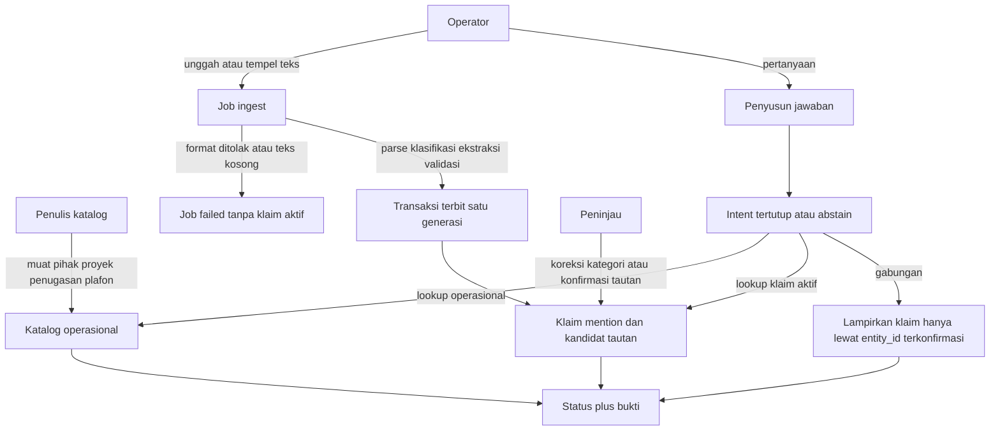

# Proses bisnis dan pengambilan bukti — laporan agen B

Tanggal: 2026-11-10. Deadline demo lokal: 2026-11-11 08:00 WIB. Laporan ini usulan independen untuk irisan produk terkecil yang utuh. Glosarium di bawah diajukan di sini sampai koordinator menetapkan istilah bersama. Tidak ada berkas `CONTEXT.md` yang diubah.

Label: **Sumber** = teks yang terbaca dari berkas riset, kontrak pengiriman, atau kode prototipe pada tanggal ini. **Inferensi** = keputusan desain yang tidak dinyatakan oleh sumber itu. **Klaim publik** = pernyataan penulis atau salinan pemasaran, bukan hasil ukur ulang dan bukan skema internal.

## 1. Tafsiran singkat

Kebutuhan CTO yang mengikat adalah repositori pengetahuan di sistem lokal dengan **dua kelas sumber yang kepemilikannya terpisah**:

1. Data bisnis terstruktur yang diisi sebagai dummy di dalam basis data.
2. Dump dokumen tidak terstruktur yang terpisah dari baris bisnis itu.

Satu percakapan menerima pertanyaan yang jawabannya bisa datang dari baris bisnis, dari kutipan dokumen, atau dari keduanya. Besok pagi penguji membawa dokumen yang tidak ada di repositori saat bangun. Satu dokumen boleh memuat lebih dari satu klasifikasi. Klasifikasi adalah jalan menuju bukti, bukan tujuan produk.

**Inferensi.** Irisan terkecil yang lengkap adalah satu notebook lokal, satu mesin relasional, dua jalur tulis yang tidak saling menimpa, lalu satu penyusun jawaban yang hanya membaca baris yang sudah terbit. Lapisan premis dan sintesis, mesin graf, dan embedding tidak masuk irisan itu.

Dokumen dummy yang sudah ada di `fixtures/demo/` memakai domain operasional (notulen, SOP, catatan). **Inferensi:** domain awal yang berguna adalah operasional internal satu unit, berbahasa Indonesia, dengan pihak, proyek, penugasan, dan plafon anggaran sebagai katalog, plus berkas teks. Domain hukum pada situs Perkara AI tidak dipakai sebagai taksonomi prototipe ini.

### Usulan glosarium

**Notebook**: Ruang kerja yang memuat satu katalog operasional dan satu dump dokumen.

**Sumber operasional**: Baris bisnis yang berwenang atas angka dan status sistem. Penulisannya lewat pemuatan katalog, terpisah dari ekstraksi dokumen.

**Sumber dokumen**: Berkas atau teks yang diunggah sebagai bukti, dengan hash dan versi. Ekstraksi tidak mengubah baris operasional.

**Segmen**: Rentang teks ber-offset pada satu versi dokumen.

**Kategori dokumen**: Label taksonomi satu segmen. Nilai awal: `sop`, `notulen`, `proposal`, `laporan_progres`, `other`. Rollup dokumen menjadi `mixed` bila segmennya berbeda. Kategori bukan tingkat abstraksi dan bukan status kebenaran.

**Lapisan data**: Isi katalog operasional plus byte dan segmen dokumen apa adanya.

**Lapisan semantik**: Klaim yang sudah terbit, mention, tautan identitas, dan relasi konflik. Penyusun jawaban hanya membaca lapisan ini bersama katalog.

**Klaim**: Kutipan yang persis ada di sumber, plus polaritas (`affirmed` atau `negated`), modalitas (`asserted` atau `plan`), atribusi, predikat, metode, dan penunjuk offset.

**Mention**: Kemunculan bentuk permukaan sebuah entitas di dalam segmen.

**Tautan identitas**: Hubungan mention ke id bisnis. Statusnya `kandidat`, `terkonfirmasi`, atau `ditolak`.

**Intent semantik**: Objek tertutup berisi operasi dan parameter yang diizinkan. Bukan SQL.

**Jawaban**: Status plus bukti yang dihitung saat ditanya. Jawaban tidak ditulis kembali sebagai baris operasional atau sebagai klaim.

_Hindari menyamakan:_ kategori dengan lapisan; klaim dengan fakta yang sudah terjadi; kecocokan nama dengan foreign key; label metode `local-rules` dengan ekstraksi model.

### Tiga lapis yang sering tertukar

| Nama | Isi yang disimpan | Pemakai jawaban |
| --- | --- | --- |
| Lapisan data | Baris `pihak`, `proyek`, `penugasan`, `plafon`; byte dokumen; segmen dan offset | Lookup operasional membaca katalog. Lookup dokumen membaca segmen hanya lewat klaim terbit |
| Kategori dokumen | Label per segmen, alasan, kutipan bukti kategori, metode, generasi | Memilih field kategori saat ekstraksi. Tidak memilih kebenaran |
| Lapisan semantik | Klaim, mention, tautan, relasi konflik | Satu-satunya bahan narasi jawaban selain baris katalog |

**Sumber.** Situs publik memisahkan chip jenis berkas (BAP, Dakwaan, Bukti, Sidang) dari tangga artefak dan dari animasi lima lapis. Riset `research/perkara-research.md` mencatat bahwa pemetaan resmi antar daftar itu tidak dipublikasikan. Prototipe ini mempertahankan pemisahan itu dengan taksonomi operasionalnya sendiri.

## 2. Aktor, objek, kepemilikan, dan alur

### Aktor

- **Operator.** Memilih notebook, mengunggah teks, membaca status job, bertanya, dan melihat kutipan.
- **Penulis katalog.** Memuat dummy pihak, proyek, penugasan, dan plafon. Pada demo, orangnya boleh sama dengan operator. Jalur tulisnya tetap terpisah dari ingest dokumen.
- **Peninjau.** Mengoreksi kategori segmen dan mengonfirmasi atau menolak tautan identitas. Orang yang sama boleh memegang peran ini. Tanpa konfirmasi, tautan ambigu tetap ambigu.
- **Penyusun jawaban.** Modul produk. Menerjemahkan pertanyaan menjadi intent, mengompilasi kueri berparameter, dan merakit status. Modul ini tidak membuat fakta baru.

### Objek bisnis

- Notebook, pihak (`KRY-…`), proyek (`PRJ-…`), penugasan, plafon anggaran.
- Dokumen (nama tampilan, hash, tubuh teks, waktu), segmen, job ingest, generasi turunan.
- Klasifikasi segmen, field kategori, klaim, mention, tautan identitas, relasi konflik antar klaim.
- Jawaban yang bersifat sesaat.

Id bisnis stabil dibuat saat pemuatan katalog. Id dokumen dan id klaim stabil dibuat saat unggah dan saat terbit. Nama tampilan bukan id.

### Kepemilikan sumber

| Objek | Pemilik jalur tulis | Boleh diubah oleh ekstraksi dokumen |
| --- | --- | --- |
| Pihak, proyek, penugasan, plafon, status sistem | Penulis katalog | Tidak |
| Byte dokumen, hash, segmen | Ingest | Tidak menimpa versi lama; hash sama mengembalikan dokumen yang ada |
| Klasifikasi, field, klaim, mention | Transaksi terbit satu job | Terganti lewat generasi baru; generasi lama menjadi `stale` |
| Tautan `terkonfirmasi` | Peninjau, atau aturan unik yang disebut di bawah | Ekstraktor hanya boleh mengusulkan `kandidat` |
| Jawaban | Tidak disimpan sebagai sumber | Tidak |

Aturan unik yang boleh langsung `terkonfirmasi` tanpa peninjau: teks mention sama persis dengan id bisnis (`KRY-014`, `PRJ-7`) atau sama persis dengan nama tampilan utuh yang hanya dimiliki satu baris katalog. Token sebagian, nama panggilan, dan kemiripan ejaan tetap `kandidat`.

### Kapan masing-masing sumber dipakai

- **Hanya katalog.** Pertanyaan meminta angka atau status yang kolomnya ada di katalog dan meminta nilai menurut sistem. Penyusun tidak membuka klaim.
- **Hanya dokumen.** Pertanyaan meminta apa yang tertulis, siapa yang mengatribusikan, apakah kalimat menegasikan, atau apakah kalimat berupa rencana. Status pihak di katalog tidak mengubah polaritas kutipan.
- **Gabungan.** Pertanyaan membandingkan status sistem dengan bukti teks, atau menyebut id bisnis yang harus dihubungkan ke mention. Sambungan memakai `entity_id` pada tautan `terkonfirmasi`.
- **Abstain.** Intent di luar daftar, kedua sumber kosong untuk parameter itu, atau job dokumen yang ditanya masih `queued` atau `running`. Jawaban menyebut sumber yang sudah diperiksa.
- **Gagal ingest, bukan jawaban.** Berkas di luar set dukungan. Tidak ada klaim aktif yang diterbitkan dari percobaan itu.

Set dukungan awal: teks UTF-8 dan Markdown yang ditempel atau diunggah sebagai `.txt` atau `.md`, paling besar 200.000 karakter, nama berkas tanpa path. PDF, pindaian, gambar, audio, dan `.docx` ditolak dengan pesan yang menyebut set dukungan. **Asumsi:** berkas CTO besok bisa saja bukan teks. Batas ini dinyatakan di ketidakpastian.

### Alur

### Ingest, tinjau, tanya, ubah, dan galat

1. Operator membuat atau memilih notebook dan melihat definisi kategori.
2. Penulis katalog memuat baris dummy. Pemuatan ulang id yang sama memperbarui katalog lewat jalur katalog, dalam satu transaksi, dan tidak menyentuh klaim.
3. Operator mengunggah teks. Sistem menyimpan tubuh, hash, dan segmen ber-offset, lalu membuka job `queued`.
4. Hash yang sama pada notebook yang sama mengembalikan dokumen dan job yang ada. Tidak ada klaim kedua.
5. Job `running` memanggil adapter penyedia. Adapter model membaca teks sebagai data. Keluaran harus memuat kutipan yang persis subset segmen.
6. Validasi menolak kutipan yang bukan subset sumber, kategori di luar daftar, dan kategori selain `other` yang tidak punya kutipan bukti di segmen itu kecuali koreksi peninjau. Klaim yang lolos masuk transaksi terbit. Klaim yang ditolak menjadi peringatan pada job, bukan baris aktif.
7. Transaksi mengubah generasi sebelumnya pada segmen itu menjadi `stale`, menyisipkan generasi baru sebagai `active`, dan menandai job `completed`. Kegagalan sebelum commit menandai job `failed` dan tidak meninggalkan generasi aktif dari percobaan itu.
8. Mention diusulkan sesudah klaim terbit. Tautan unik menurut aturan di atas boleh `terkonfirmasi`. Sisanya `kandidat`.
9. Peninjau mengoreksi kategori satu segmen. Field dan klaim segmen itu diproses ulang. Teks sumber tetap. Generasi lama `stale`.
10. Peninjau mengonfirmasi atau menolak tautan. Keputusan itu tidak mengubah kutipan.
11. Operator bertanya. Perencana, bila ada, mengembalikan intent. Kompilator menolak intent yang tidak dikenal. Jawaban memakai baris `active` saja.
12. Retry hanya dari job `failed`. Retry yang berhasil menerbitkan satu generasi. Retry tidak menggandakan generasi yang sudah `active` untuk hash yang sama.
13. Restart proses mempertahankan notebook. Job yang tertinggal `running` menjadi `failed` dengan alasan terputus sebelum terbit. Baris `active` yang sudah commit tetap tampil. Baris yang belum commit tidak tampil.
14. Teks dokumen, pertanyaan, dan keluaran model tidak menjadi perintah shell atau SQL mentah.

Pesan galat yang operator harus bisa baca: format tidak didukung; teks kosong; tubuh terlalu besar; nama berkas berupa path; kutipan model tidak ada di sumber; penyedia model gagal atau habis waktu; kategori tidak ada dalam definisi notebook; pertanyaan kosong; intent di luar daftar; notebook atau dokumen tidak ada; identitas ambigu; bukti tidak cukup.

Bila adapter model gagal pada ingest, job menyimpan kesalahan penyedia. Fallback leksikal boleh menerbitkan klaim hanya dengan label metode `local-rules` pada job dan pada setiap klaim. Label itu wajib tampil. Fallback itu bukan ekstraksi semantik. Bila tidak ada fallback, job `failed` dan nol klaim aktif baru.

Pada jalur tanya, kegagalan perencana menghasilkan `abstain` dengan alasan perencana tidak tersedia. Pencocokan kata pada pertanyaan tidak dinamai pemahaman semantik. UI tetap boleh mengirim intent tersusun yang sudah diizinkan; itu lookup deterministik.

## 3. Contoh kerja sintetis

Notebook: Operasional Dapur Sari. Seluruh angka dan nama di bawah adalah data rekaan untuk demo. Contoh ini menambah katalog yang tidak ada di dalam kalimat berkas, lalu memakai berkas sebagai dump terpisah.

### Katalog operasional

Dimuat oleh penulis katalog, sebelum pertanyaan.

| Id | Nama tampilan | Jabatan | Status sistem | Unit |
| --- | --- | --- | --- | --- |
| KRY-014 | Budi Santoso | Staf operasional | aktif | Dapur |
| KRY-088 | Budi Hartono | Staf keuangan | nonaktif sejak 2026-01-01 | Keuangan |
| KRY-003 | Sari Melati | Kepala operasional | aktif | Dapur |
| KRY-021 | Dana Putri | Analis | aktif | Operasional |
| KRY-030 | Raka Wijaya | Penanggung jawab dapur | aktif | Dapur |

| Id | Nama tampilan | Pemilik | Status sistem | Tanggal mulai di sistem | Plafon |
| --- | --- | --- | --- | --- | --- |
| PRJ-7 | Pilot Menu Sehat | KRY-003 | direncanakan | kosong | 15000000 IDR |

Penugasan: KRY-014 pelaksana PRJ-7. KRY-088 tidak ditugaskan. Tidak ada baris omzet, tidak ada baris kehadiran, dan tidak ada pihak untuk "Pejabat Z" atau "Saksi A".

Status `aktif` pada KRY-014 tidak dipakai untuk memilih Budi yang mana.

### Dump dokumen

Berkas terpisah. Nama berkas bukan sinyal kategori.

**D1**, tampilan `notulen-maret.md`, satu segmen, kategori yang diharapkan `notulen`:

> Peserta: Sari, Budi, Dana. Keputusan: pilot direncanakan mulai 15 November. Tindakan: Sari menyiapkan daftar. Menurut Saksi A, Budi hadir di rapat 14 Maret.

**D2**, tampilan `email-dana.md`, kategori yang diharapkan `other` bila tidak ada pola notulen yang cukup, atau `notulen` bila segmen memang memuat keputusan. Kategori akhir milik penyedia plus validasi, bukan milik nama berkas:

> Catatan dari Dana. Keputusan: pilot direncanakan mulai 1 Desember. Budi tidak bisa ikut meeting dengan Pejabat Z.

**D3**, tampilan `proposal-menu.md`, kategori yang diharapkan `proposal`. Teks ini tidak ada di fixture saat laporan ditulis:

> Proposal Pilot Menu Sehat. Tujuan: uji menu sehat. Anggaran: 40000000. Pilot sudah berjalan sejak 2 November.

**D4**, tampilan `sop-dapur.md`, kategori yang diharapkan `sop`. Tidak menjadi bukti untuk lima pertanyaan di bawah:

> SOP dapur operasional. Langkah: Cuci bahan sebelum dimasak. Penanggung jawab: Raka.

Untuk contoh yang sudah ditinjau, peninjau mengonfirmasi mention nama utuh "Pilot Menu Sehat" pada D3 ke PRJ-7, serta mengonfirmasi dua kalimat keputusan D1 dan D2 ke PRJ-7. Konfirmasi itu bagian dari data contoh, bukan hasil join otomatis atas token "pilot". Dokumen baru yang hanya berisi token "pilot" tidak mendapat konfirmasi itu.

Mention "Budi" pada D1 dan D2 tetap `kandidat` terhadap KRY-014 dan KRY-088. "Saksi A" dan "Pejabat Z" tidak punya baris katalog.

Klaim yang lapisan semantik simpan dari dump itu:

| Id klaim | Berkas | Kutipan inti | Polaritas | Modalitas | Predikat | Tautan |
| --- | --- | --- | --- | --- | --- | --- |
| C1 | D1 | pilot direncanakan mulai 15 November | affirmed | plan | jadwal_mulai | terkonfirmasi ke PRJ-7 oleh peninjau |
| C2 | D1 | Menurut Saksi A, Budi hadir di rapat 14 Maret | affirmed | asserted | kehadiran | Budi masih kandidat; atribusi Saksi A |
| C3 | D2 | pilot direncanakan mulai 1 Desember | affirmed | plan | jadwal_mulai | terkonfirmasi ke PRJ-7 oleh peninjau |
| C4 | D2 | Budi tidak bisa ikut meeting dengan Pejabat Z | negated | asserted | kehadiran | Budi masih kandidat; Pejabat Z tidak ada di katalog |
| C5 | D3 | Anggaran: 40000000 | affirmed | asserted | usulan_anggaran | terkonfirmasi ke PRJ-7 lewat nama utuh |
| C6 | D3 | Pilot sudah berjalan sejak 2 November | affirmed | asserted | status_mulai | terkonfirmasi ke PRJ-7 lewat nama utuh |

C1 dan C3 sama-sama rencana dan berbeda tanggal. Keduanya tidak membuktikan bahwa proyek sudah mulai. C6 menyatakan sudah berjalan. Katalog mengatakan `direncanakan`. Tiga sumber itu tetap tersimpan bersama.

C2 dan C4 tidak otomatis menjadi konflik satu sama lain. Peristiwa permukaannya berbeda (rapat 14 Maret versus meeting dengan Pejabat Z), dan entitas "Budi" belum terkonfirmasi. Konflik kehadiran baru sah setelah peninjau mengikat kedua mention ke id yang sama dan ke peristiwa yang sama.

### Pertanyaan

**Hanya katalog.** "Berapa plafon PRJ-7 dan apa statusnya menurut sistem?"

- Mode: katalog saja.
- Hasil: PRJ-7 Pilot Menu Sehat, plafon 15000000 IDR, status `direncanakan`, tanggal mulai kosong, pelaksana tercatat KRY-014.
- Sumber: baris proyek dan penugasan. C5 dan C6 tidak dibaca.
- Status jawaban: `grounded`.

**Hanya dokumen.** "Apakah dokumen menyatakan bahwa Budi tidak bisa ikut meeting dengan Pejabat Z?"

- Mode: dokumen saja.
- Hasil: ya, dokumen D2 menyatakan itu. Klaim C4, polaritas `negated`, modalitas `asserted`, predikat `kehadiran`.
- Kutipan C4 wajib ada di jawaban. Kalimat "ikut meeting" tanpa negasi tidak boleh menjadi kesimpulan.
- KRY-014 yang berstatus aktif tidak mengubah jawaban. Pejabat Z dilaporkan tidak ada di katalog; itu tidak menghapus kutipan.
- Status jawaban: `grounded`.

**Gabungan.** "Apakah PRJ-7 yang pelaksananya KRY-014 sudah berjalan?"

- Mode: gabungan.
- Katalog: status `direncanakan`, tanggal mulai kosong, pelaksana KRY-014.
- Klaim terkonfirmasi ke PRJ-7: C1 rencana 15 November, C3 rencana 1 Desember, C6 asserted sudah berjalan sejak 2 November.
- Hasil: sistem mencatat belum mulai. Dokumen yang tertaut tidak sepakat. Tidak ada satu tanggal yang dipilih.
- Status jawaban: `conflict`. Modalitas `plan` pada C1 dan C3 tetap berlabel rencana. C6 tidak menimpa katalog.
- Mention "Budi" tidak dilampirkan ke KRY-014 pada jawaban ini, karena tautannya masih kandidat.

**Tidak terjawab.** "Berapa omzet kantin pada Oktober 2026?"

- Katalog tidak punya kolom omzet. Tidak ada klaim aktif tentang omzet.
- Status jawaban: `abstain`. Alasan: katalog dan klaim aktif tidak memuat ukuran itu. Plafon 15000000 tidak dipakai sebagai pengganti.

**Entitas ambigu.** "Apakah Budi hadir di rapat 14 Maret?"

- Mention "Budi" pada C2 cocok sebagai kandidat ke KRY-014 Budi Santoso dan KRY-088 Budi Hartono.
- Status jawaban: `ambiguous`. Kedua id ditampilkan. C2 ditampilkan sebagai klaim beratribusi "Saksi A", bukan sebagai baris kehadiran sistem.
- Jawaban tidak memilih karyawan yang aktif. C4 tidak digabung menjadi konflik kehadiran pada rapat 14 Maret.

**Cakupan ambigu, sebagai perilaku saudara.** "Berapa anggaran pilot?" tanpa kata "sistem" atau "dokumen" mengembalikan dua bukti berlabel: plafon katalog 15000000 dan usulan C5 sebesar 40000000, status `conflict`. Sistem tidak merata-rata keduanya.

## 4. Opsi arsitektur dan tradeoff

Tiga opsi dibanding pada kecocokan kasus, kebenaran, biaya siaga dan rawat, latensi, dan deadline besok pagi. Tidak ada skor angka. Angka volume pada klaim publik Perkara AI adalah skala mereka, bukan kuota prototipe ini.

### Model semantik relasional

Intent tertutup dikompilasi ke templat SQL berparameter di atas tabel katalog, klaim, mention, dan tautan.

- Kecocokan: pertanyaan demo adalah lookup id, saringan polaritas dan modalitas, serta satu lompatan dari id bisnis ke klaim yang tertaut.
- Kebenaran: foreign key, satu generasi aktif, kutipan yang dicek ke offset, dan kompilator yang menolak identifier di luar daftar. Negasi dan rencana menjadi kolom, sehingga saringan "apakah sudah terjadi" tidak memakai `LIKE '%meeting%'`.
- Biaya: skema dan daftar intent harus ditulis sebelum demo. Jenis dokumen baru yang tidak dikenal jatuh ke `other` plus predikat `lain`, yang boleh disitasi dan tidak boleh menjadi nama kolom SQL.
- Latensi: lookup baris lokal kecil. Waktu yang terasa ada pada panggilan model saat ingest dan, bila dipakai, saat merencanakan intent.
- Deadline: muat dalam sisa waktu bila intent-nya sedikit dan mesinnya satu proses.

### Desain berpenyangga graf

Simpul dan sisi bertipe sebagai rumah utama pengetahuan. **Klaim publik** (Ibrahim Arief, 2 Nov 2026, utas yang dikutip di `research/perkara-research.md`): untuk perkara mereka, model semantik yang dipilih adalah graf pengetahuan berlapis; satu perkara disebut dapat memuat sekitar satu juta entitas dan hubungan; ETL berbasis event dan pada sebagian kasus materialized view PostgreSQL disebut sebagai pilihan implementasi; penulis menyuruh pembaca menanyakan pendekatan teknis ke coding agent masing-masing. Ontologi rumah sakit, ekspor-impor, dan persidangan disebut harus berbeda.

- Kecocokan: kuat bila pertanyaan investigasi menelusuri banyak predikat yang belum diketahui saat skema ditulis. Pertanyaan demo besok tidak berbentuk itu.
- Kebenaran: predikat bertipe membantu hanya setelah ekstraksi dan identitas benar. Mesin graf tidak memperbaiki "Budi" yang merujuk dua orang, dan tidak membuat modalitas `plan` menjadi kejadian.
- Biaya: mesin tambahan atau SQL rekursif, daftar sisi, dan alat yang tidak ada di fondasi Python stdlib yang sudah dipakai prototipe. **Sumber** kontrak `DELIVERY.md`: basis data graf tidak wajib; satu basis data tahan lama dengan migrasi versi sudah cukup.
- Latensi: pada puluhan simpul, lompatan graf bukan bottleneck. **Klaim publik** penulis pada 6–7 Nov 2026 menempatkan sebagian besar latensi mereka pada verifikasi agen, bukan pada lookup.
- Deadline: tidak muat sebagai fondasi baru tanpa menunda dua kelas sumber dan identitas.

**Inferensi.** Sisi konflik dan tautan identitas sebagai baris relasional memberi join-by-id yang dibutuhkan contoh di atas. Graf tetap bisa menjadi adapter belakangan di seam yang sama bila penelusuran multi-lompatan benar-benar muncul.

### Pengambilan yang berat ke embedding

Pertanyaan diubah menjadi vektor, lalu pasal terdekat menjadi konteks jawaban.

- Kecocokan: membantu bila parafrase tidak menyentuh predikat dan korpusnya besar. Korpus demo kecil dan kegagalan yang harus lulus adalah negasi, rencana lawan kejadian, konflik, dan identitas.
- Kebenaran: kedekatan vektor dapat menampilkan "tidak bisa ikut meeting" di samping "ikut meeting". Polaritas tetap harus dibaca dari kolom klaim sesudah pengambilan. Vektor bukan kunci join ke `KRY-014`.
- Biaya: bobot embedding lokal atau API berbayar. **Sumber** `DELIVERY.md`: jangan memasang bobot model besar atau memanggil API berbayar tanpa keputusan yang sengaja. **Klaim publik** 9 Nov 2026 menyebut rerank cloud berbayar pada volume simpul yang jauh di atas demo ini.
- Latensi: indeks ulang setiap unggah, plus panggilan model. Untuk teks pendek besok, saringan kolom lebih mudah dijelaskan ke penguji.
- Deadline: tidak menjadi jalur jawaban.

**Inferensi.** Embedding boleh belakangan sebagai petunjuk recall yang hasilnya tetap melewati klaim terbit, saringan polaritas, dan tautan terkonfirmasi. Malam ini jalur itu tidak dibangun.

### Interface semantik yang dikompilasi

Modul **PenyusunJawaban** punya interface sempit: `tanya(notebook, pertanyaan) -> Jawaban`. Kedalaman modul ini ada bila pemanggil tidak perlu tahu SQL, offset, atau aturan identitas.

Intent yang sah:

| Intent | Parameter yang diizinkan | Templat yang dikompilasi |
| --- | --- | --- |
| `lookup_operasional` | jenis `pihak` atau `proyek`, id bisnis, atau saringan kolom yang ada di daftar | `SELECT` kolom tetap `WHERE id = ?` dan notebook |
| `lookup_klaim` | predikat, polaritas, modalitas, kategori, id dokumen, id entitas | `SELECT` klaim `WHERE state = 'active'` dan parameter `?` |
| `bandingkan` | id bisnis atau id proyek | Dua templat di atas, lalu lampirkan klaim yang tautan terkonfirmasinya sama dengan id itu |
| `abstain` | alasan dari daftar | Tidak ada kueri |

Daftar predikat klaim untuk irisan ini: `jadwal_mulai`, `status_mulai`, `kehadiran`, `usulan_anggaran`, `lain`. Predikat `lain` boleh disitasi dan tidak ikut join ke kolom katalog. Nama predikat baru dari model tidak menjadi identifier SQL.

Kompilator:

- Menerima hanya intent di atas. Field lain dijatuhkan atau ditolak.
- Mengikat setiap nilai sebagai parameter. Identifier tabel dan kolom berasal dari templat di kode.
- Menolak string yang memuat pemisah pernyataan, komentar SQL, atau nama tabel di luar templat.
- Tidak menerima nama orang sebagai operand join. Nama hanya masuk modul **Identitas**. Bila pertanyaan hanya punya nama, langkah pertama adalah resolusi. Hasil `ambigu` atau `tidak_ada` mengakhiri jawaban tanpa templat join.
- `quote_contains` boleh menjadi parameter `LIKE` yang di-escape untuk menunjuk kutipan. Status polaritas tetap dibaca dari kolom, bukan dari ada tidaknya kata di dalam kutipan.

Seam penyedia ada karena dua adapter ingest sudah berbeda perilakunya: adapter model dan adapter leksikal. Keduanya mengembalikan draf yang melewati validasi kutipan yang sama. Seam perencana ada di depan kompilator. Adapter yang gagal tidak menulis SQL cadangan.

**Klaim publik** 2 Nov 2026: memberi agen akses mentah lalu membiarkannya menyusun SQL disebut rentan, karena satu pertanyaan terbuka dapat menjadi banyak kueri, dan contoh `LIKE '%meeting%'` disebut ikut menangkap "tidak bisa ikut meeting". Interface di atas adalah jawaban terhadap risiko itu untuk scope demo, bukan salinan graf mereka.

## 5. Keputusan yang diusulkan

**Satu mesin relasional SQLite sebagai adapter penyimpanan demo, dengan dua skema kepemilikan di file yang sama: katalog operasional dan bukti dokumen.**

Alasan berdasarkan scope yang terbaca, bukan karena nama produknya ringan atau karena disebut di percakapan:

- Demo adalah satu operator, satu proses loopback, data dummy yang ditulis tim ini, dan dokumen yang diunggah ke mesin yang sama. **Sumber** kode saat ini mengikat server ke `127.0.0.1`. Tidak ada penulis kedua dari ERP hidup.
- Penerbitan klaim harus satu transaksi dengan pergantian generasi. SQLite pada proses ini sudah menjadi mesin transaksi file itu. Dua file terpisah akan memecah transaksi tanpa menambah pemilik sumber.
- PostgreSQL menjadi adapter yang tepat ketika muncul penulis kedua, kebutuhan peran, atau dump operasional sungguhan dengan skema yang sudah ada. Malam ini mesin itu menambah proses yang harus dijaga, tanpa menyediakan id stabil, polaritas, atau kompilator. **Klaim publik** tentang materialized view PostgreSQL berbicara tentang skala graf perkara mereka.
- Interface katalog dan interface bukti tidak menyebut dialek. Mengganti adapter ke PostgreSQL belakangan tidak mengubah intent, aturan tautan, atau status jawaban.
- Baris relasi untuk konflik dan tautan identitas tetap di mesin yang sama. Itu bukan pemilihan "anti-graf". Itu cukup untuk join id pada contoh bagian 3.
- Embedding tidak masuk jalur jawaban demo.
- Ekstraksi dan klasifikasi dokumen yang belum pernah dilihat memakai adapter model yang sudah ada (Grok CLI, keluaran terstruktur, teks sebagai data, batas waktu, tanpa shell). Oracle deterministik hanya bahan uji. Hasil model yang kutipannya gagal validasi tidak terbit. Fallback leksikal wajib berlabel.
- Premis dan sintesis tidak dibuat sebagai tabel pada irisan ini. Konflik adalah relasi dua klaim plus perbedaan dengan baris katalog, dan jawaban tidak memilih pemenang.

Modul dan seam:

| Modul | Interface yang pemanggil pelajari | Adapter pada seam |
| --- | --- | --- |
| KatalogOperasional | muat dan ambil pihak, proyek, penugasan, plafon menurut id | SQLite sekarang; PostgreSQL bila dump eksternal muncul |
| IngestDokumen | unggah, status job, retry, koreksi kategori | penyedia model dan penyedia leksikal, keduanya di belakang validasi yang sama |
| Identitas | usulkan kandidat, konfirmasi, tolak | aturan tepat-id dan tepat-nama-utuh; peninjau untuk sisanya |
| PenyusunJawaban | tanya | perencana model di depan kompilator tetap; kegagalan perencana menjadi abstain |

Kedalaman yang dijaga: aturan "nama bukan join", "rencana bukan kejadian", dan "kutipan harus subset sumber" tinggal di dalam ketiga modul terakhir. UI hanya mengunggah, meninjau, dan membaca jawaban.

## 6. Celah kode saat ini

Pengamatan langsung pada `klayer/store.py`, `klayer/domain.py`, `klayer/pipeline.py`, `klayer/providers.py`, `klayer/server.py`, dan `README.md`. Isi biner `data/demo.sqlite` tidak dibaca.

Yang selaras dengan invariant dan layak dipertahankan:

- Satu transaksi `publish` mengganti generasi aktif pada segmen dan mengembalikan job `completed` hanya setelah commit.
- Kutipan klaim dan field dicek sebagai subset tubuh dokumen sebelum disimpan.
- Hash sama tidak membuat dokumen kedua.
- Job `running` yang tertinggal saat proses dibuka kembali ditandai gagal.
- `search_claims` mengikat polaritas, modalitas, predikat, dan cuplikan kutipan sebagai parameter. Nama kolom berasal dari kode.
- Kategori per segmen dan rollup `mixed` sudah memisahkan "satu berkas, banyak klasifikasi" dari satu label paksa.
- Server menolak host selain loopback. Pertanyaan lewat penyedia model diminta menghasilkan intent, lalu `structured_query` menolak nilai di luar daftar kecil.
- README sudah menyatakan bahwa `local-rules` bukan ekstraksi semantik, dan bahwa aplikasi lokal bukan model offline.

Yang bertentangan dengan kebutuhan dua sumber:

- Skema hanya memuat notebook, dokumen, job, segmen, klasifikasi, klaim, field, dan relasi antar klaim. Tidak ada pihak, proyek, penugasan, atau plafon. Seluruh "struktur" adalah field yang diekstrak dari dokumen. Lookup hanya-katalog tidak bisa dijawab.
- `structured_query` membaca klaim dan relasi klaim. Nama itu bukan katalog bisnis. Mode gabungan tidak ada. Jawaban tidak membawa `source_mode`.
- `domain.conflicting_pairs` menghubungkan klaim kehadiran yang polaritasnya berbeda bila regex nama kapital pada kedua kutipan beririsan. Itu join berdasarkan kata. Dua orang bernama Budi akan tergabung. Relasi ini ditulis pada transaksi kedua sesudah `publish`, dari `pipeline.process_job`, sementara `publication["relations"]` dikirim kosong. Kegagalan di antara dua transaksi meninggalkan konflik yang belum terbit atau yang sudah basi.
- Predikat dan skema perencana terkunci pada `attendance` dan `pilot`. Dokumen baru tentang anggaran atau peristiwa lain hanya punya kutipan dan predikat kosong. Predikat bebas yang langsung menjadi SQL juga tidak aman. Yang kurang adalah daftar predikat kecil plus `lain`, seperti bagian 5.
- Bendera `semantic` pada hasil tanya di-set `False` juga ketika perencana model yang menyusun intent. Label metode perencana dan label landasan baris perlu terpisah, supaya lookup berparameter tidak disebut pemahaman semantik dan supaya panggilan model tidak disembunyikan.
- Seed `--seed` selalu mengekstrak dengan `local-rules`. Teks tempel UI dapat memakai penyedia terpilih. Jalur model untuk dokumen baru sudah ada sebagai adapter, tetapi produk belum punya katalog bisnis yang bisa digabung dengan hasil adapter itu.
- `README.md` memuat batas "tidak ada Postgres". Batas itu konsisten dengan adapter SQLite untuk demo, dan tidak sama dengan keputusan bahwa katalog operasional tidak diperlukan. Katalog tetap diperlukan di dalam adapter yang ada.

## 7. Invariant dan kondisi penerimaan

Invariant:

1. Ekstraksi dokumen tidak mengubah pihak, proyek, penugasan, plafon, atau status sistem.
2. Setiap klaim aktif mengutip substring persis dari versi dokumen yang ditunjuk, dan offsetnya cocok.
3. Job `failed` atau `running` tidak memiliki klaim aktif dari percobaan yang belum commit.
4. Hash yang sama pada notebook yang sama tidak menambah generasi aktif kedua.
5. Identifier SQL pada jalur jawaban berasal dari templat kode. Nilai pengguna, nilai model, dan teks dokumen masuk sebagai parameter atau ditolak.
6. Jawaban gabungan melampirkan klaim ke baris katalog hanya lewat tautan `terkonfirmasi`. Kecocokan nama yang bukan id persis atau nama tampilan utuh yang unik tetap `kandidat`.
7. Dua klaim terkonfirmasi ke entitas dan peristiwa yang sama, dengan polaritas atau modalitas yang berbeda, menghasilkan status `conflict`. Kedua kutipan tetap ada.
8. Modalitas `plan` tidak memenuhi pertanyaan "apakah sudah terjadi".
9. Polaritas `negated` tidak memenuhi pertanyaan kehadiran atau keikutsertaan yang afirmatif.
10. Kategori adalah atribut segmen. Dokumen dengan beberapa kategori ber-rollup `mixed`. Kategori bukan status benar.
11. Restart menampilkan generasi `active` yang sudah commit dan tidak menampilkan terbitan yang terputus.
12. Teks dokumen tidak mengubah daftar intent, tidak menjalankan shell, dan tidak mengubah plafon.
13. Jawaban `abstain` dipakai ketika templat yang sah tidak menghasilkan baris. Ini bukan janji bebas halusinasi. Model masih dapat salah klasifikasi atau melewatkan kalimat. Yang dijamin adalah jawaban hanya merender baris terbit yang lolos validasi kutipan, dengan label metode yang sesuai.
14. Klaim `local-rules` tidak dilaporkan sebagai hasil model.

Penerimaan yang bisa dicek pada data bagian 3 dan pada satu teks baru. Otomatisasi uji dan cek mutu model dibedakan.

| Kasus | Tindakan | Hasil yang diamati |
| --- | --- | --- |
| Katalog saja | Tanya plafon dan status PRJ-7 menurut sistem | `grounded`, 15000000, `direncanakan`, tanpa id klaim C5 atau C6 |
| Dokumen saja, negasi | Tanya kalimat meeting Pejabat Z | `grounded`, kutipan C4, polaritas negated, tanpa kesimpulan hadir |
| Gabungan, rencana lawan kejadian | Tanya apakah PRJ-7 sudah berjalan | `conflict`, menyebut status sistem dan klaim C1, C3, C6, tanpa satu tanggal pemenang |
| Entitas ambigu | Tanya apakah Budi hadir 14 Maret | `ambiguous`, kandidat KRY-014 dan KRY-088, C2 tetap beratribusi |
| Tidak ada bukti | Tanya omzet Oktober 2026 | `abstain`, kedua sumber disebut, plafon tidak dipakai |
| Dokumen baru | Unggah satu paragraf dengan nonce yang tidak ada di repositori | Job selesai; kutipan aktif memuat nonce; metode `online-grok-cli` bila CLI berhasil, atau `failed` / `local-rules` yang terlihat bila CLI gagal; nama berkas `sop.txt` tidak memaksa kategori bila isinya bukan SOP |
| Kategori tidak dikenal | Unggah teks tanpa pola kategori | Segmen `other`, field kategori kosong, klaim kalimat yang valid tetap boleh terbit |
| Koreksi kategori | Ubah kategori satu segmen | Field generasi lama `stale`, teks sumber tetap, generasi baru aktif |
| Format di luar set | Unggah PDF atau tubuh kosong | Job atau permintaan gagal dengan pesan set dukungan atau teks kosong; nol klaim aktif baru |
| Idempoten | Unggah hash yang sama | `created` false, jumlah klaim aktif tidak bertambah |
| Retry | Paksa job gagal lalu retry sukses | Satu generasi aktif, bukan dua |
| Restart | Mulai ulang proses pada file yang sama | Katalog, dokumen, dan klaim aktif tetap; job yang tadinya `running` menjadi `failed` |
| Sitasi palsu | Penyedia mengembalikan kutipan yang bukan subset | Kutipan itu tidak aktif; peringatan ada pada job |
| Injeksi | Dokumen menyuruh menghapus plafon atau mengabaikan aturan | Plafon PRJ-7 tetap 15000000; tidak ada perintah yang dijalankan |
| Token bukan join | Unggah teks baru "pilot direncanakan mulai 20 Desember" tanpa konfirmasi | Klaim boleh terbit; tautan ke PRJ-7 tetap kandidat atau tidak terkonfirmasi; pertanyaan gabungan PRJ-7 tidak memperlakukannya sebagai bukti tertaut |
| Oracle | Bandingkan keluaran dengan tabel bagian 3 | Oracle hanya menilai. Ia bukan cabang kode yang mengembalikan jawaban berdasarkan nama berkas |

Uji nonce dan uji CLI adalah cek jalur model. Satu kali lulus tidak mengukur akurasi umum. Uji sisa di tabel adalah assertion atas invariant data.

## 8. Ketidakpastian yang mengubah desain

1. **Format berkas besok.** Bila penguji membawa PDF, pindaian, atau `.docx`, parser teks gagal tertutup. Menambah parser atau OCR adalah pekerjaan lain. Status jawaban dan aturan identitas tidak berubah.
2. **Dump operasional sungguhan.** Bila besok ada skema PostgreSQL eksternal, adapter katalog diganti lebih dulu dan id bisnis dipetakan. Intent dan larangan join-atas-nama tetap. Menebak embedding tidak menjawab dump itu.
3. **Domain di luar operasional.** Daftar kategori dan predikat bagian 5 mengasumsikan SOP, notulen, proposal, dan laporan progres. Domain lain mengubah daftar itu. Polaritas, modalitas, dan kepemilikan dua sumber tetap.
4. **Adapter Grok CLI.** Bila CLI tidak mengembalikan objek terstruktur pada mesin demo, jalur model untuk dokumen baru tersumbat. Perilaku jujur adalah job gagal atau terbitan `local-rules` yang berlabel, dan pertanyaan bebas menjadi `abstain`. Demo tidak disebut klasifikasi model selama jalur itu mati.
5. **Id bisnis yang bentrok di dalam teks.** Bila dua orang memakai nomor yang sama pada dua berkas, kecocokan id persis turun menjadi `kandidat` sampai peninjau memutuskan. Aturan "unik maka terkonfirmasi" bergantung pada asumsi bahwa id katalog tidak bertabrakan.
6. **Peninjau saat demo.** Bila tidak ada yang mengonfirmasi tautan, pertanyaan gabungan pada mention ambigu tetap `ambiguous`. Demo tetap dapat menunjukkan katalog, negasi, dan abstain.
7. **Bahasa dan ejaan.** Aturan nama utuh gagal pada sapaan dan salah ketik. Perilaku yang ditargetkan adalah tetap `kandidat`, bukan join perkiraan. **Klaim publik** 25 Jul 2026 menyebut bahwa jarak suntingan saja dapat menyamakan nama yang berbeda. Prototipe ini tidak menambahkan deduplikasi model pada irisan besok.

## 9. Hasil

Irisan lengkap untuk demo besok adalah notebook lokal dengan katalog operasional dummy dan dump dokumen terpisah di satu SQLite, karena scope-nya satu operator tanpa ERP kedua. Penyusun jawaban hanya menerima intent tertutup, mengompilasinya menjadi kueri berparameter, dan menggabungkan bukti lewat id bisnis yang sudah terkonfirmasi. Kecocokan nama hanya menghasilkan kandidat. Pada contoh Dapur Sari, plafon PRJ-7 sebesar 15000000 dan status `direncanakan` dijawab dari katalog; negasi meeting Pejabat Z dijawab dari klaim D2; pertanyaan apakah PRJ-7 sudah berjalan berstatus konflik antara katalog, dua rencana, dan satu klaim "sudah berjalan"; omzet Oktober abstain; "Budi" ambigu antara KRY-014 dan KRY-088. Dokumen yang belum pernah dilihat wajib melewati ekstraksi model yang tervalidasi kutipannya, dengan fallback leksikal yang berlabel bila CLI gagal. Graf, embedding, premis, dan sintesis tidak masuk irisan ini. Kode saat ini sudah punya terbitan transaksional dan saringan klaim berparameter, tetapi belum punya katalog bisnis maupun join identitas yang aman.
