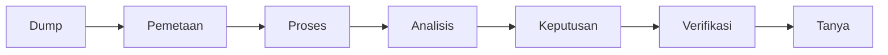

# Notebook operasional

Aplikasi Rails ini yang dijalankan. Jangan mulai dari berkas ini.

Baca dulu [README akar](../README.md), bagian **Bacaan sebelum mencoba**, lalu kerjakan bagian **Coba sendiri**. Setelah server hidup, baca [PENGGUNAAN.md](../PENGGUNAAN.md). Bagan alurnya ada di [DIAGRAM.md](../DIAGRAM.md). Empat berkas pertama yang diunggah sendiri ada di `fixtures/demo/`, urutannya tertulis di README akar.



Rails 7.0.10, Ruby 3.3.2, PostgreSQL. Jawaban bertanda `rules` dan `semantic false`. Model belum dipasang.

```bash
export RBENV_VERSION=3.3.2
export SDKROOT="$(xcrun --sdk macosx --show-sdk-path)"
bundle install
bin/rails db:prepare
bin/rails test
bin/ops
```

Server lokal: http://127.0.0.1:3000

Tombol **Buka contoh produk** membuat notebook, rekaman, dan berkas contoh. Teks yang sama tidak disimpan dua kali. Rencana tidak dihitung sebagai kejadian. Kutipan kehadiran yang saling menolak tampil sebagai bentrok.

Halaman **Proses** memuat peta alur dan adegan 150 PDF. Tautan **Riset dan perbandingan** membuka `/riset`. Keduanya dijelaskan di README akar dan di `PENGGUNAAN.md`.
